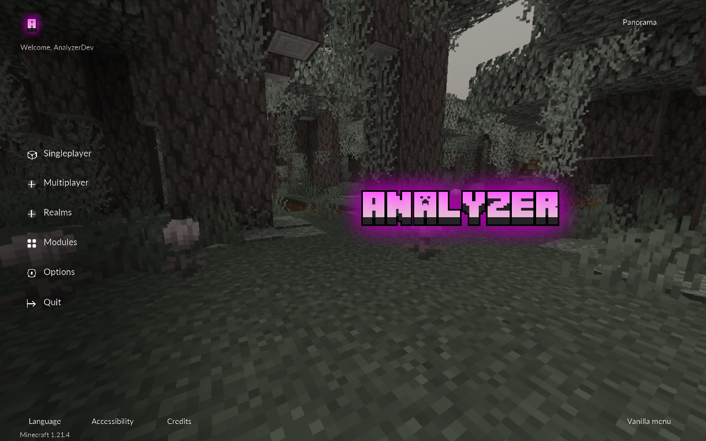
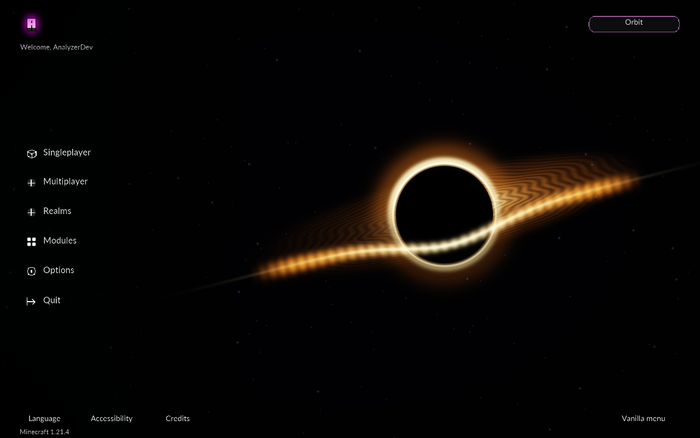
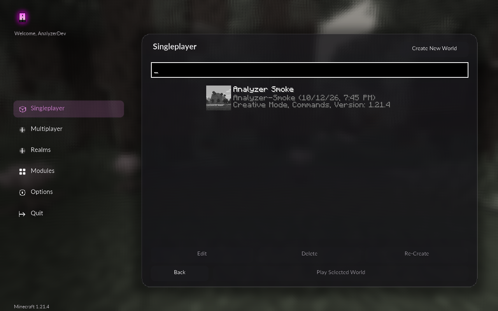
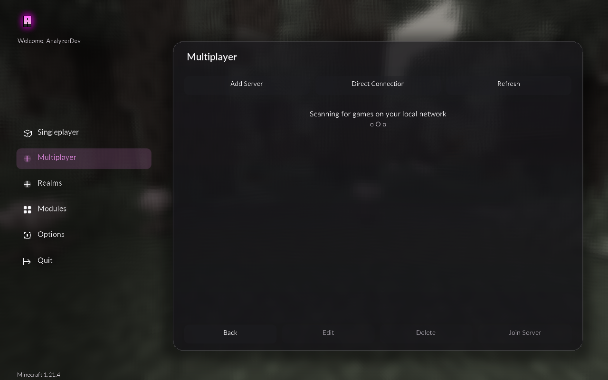
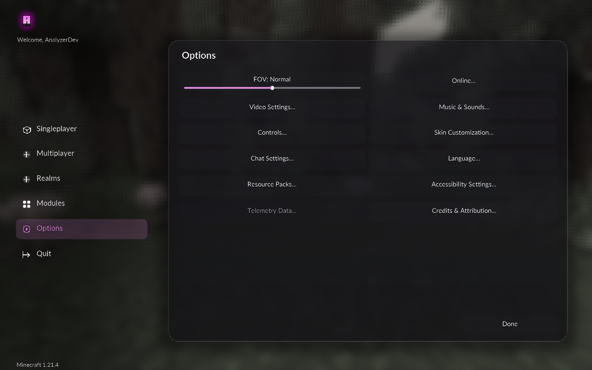

# Analyzer Home — 0.7.1

The custom title screen opens by default over **Minecraft's panorama**. Left navigation leads to Singleplayer, Multiplayer, Realms, Modules, Options and Quit. Language, Accessibility and Credits are available along the footer. The supplied transparent artwork replaces the old generated Home logo/text. Selected navigation uses the menu accent; the supplied logo colors and glow stay unchanged. Shader surfaces and Lato text use Minecraft's native Screen/input system.



## Appearance controls

Open **Modules → Appearance → HUD Studio → Home screen** (or Interface) to change these shared, saved preferences:

| Setting | Default | Behavior |
| --- | --- | --- |
| Custom home screen | On | Replaces Minecraft's title screen. Turn it off to keep the vanilla title. |
| Home background | Panorama | Choose Minecraft's panorama or **Orbit**, an original procedural starfield and gold disk. The top-right background button also switches and saves this choice. |
| Home animation | 0.65 | Controls panorama rotation and Orbit motion. Zero freezes both. Panorama also respects Minecraft's own panorama-speed option. |
| Blur home submenus | On | Softens the scene behind the world, server and options pages. The main Home stays crisp. |

**Vanilla menu** in the bottom-right saves the fallback preference. Minecraft's vanilla title then includes **Custom Home** to turn it back on. Menu layout, menu theme/accent and HUD theme remain separate; Studio / Workspace / Classic / Compact and Glass / Classic / Minimal / Neon are retained. Existing preferences and saved profile files are preserved by updates. Loading a profile remains an explicit replacement of active settings.



## Native pages

Singleplayer wraps Minecraft's real world list, search, Create New World, Play, Edit, Delete and Re-Create controls. Multiplayer wraps the real saved-server list, LAN discovery, add/direct/refresh, edit/delete and join actions. Selected entries and account permissions determine which actions are enabled. Native multiplayer warnings remain in place. Options keeps the real FOV slider and Minecraft options callbacks; deeper settings screens use their native interfaces. Realms opens Minecraft's normal Realms screen subject to the account's permission.







Back/Escape returns these pages to their Home parent. Opening any of the four Analyzer layouts from Home and closing it also returns Home. In-game menu behavior remains available through Right Shift. No world is auto-loaded, no server is auto-joined and no automation task starts from Home.

The implementation uses original GLSL for Orbit, scene blur and rounded surfaces. Blur samples a separate scene copy; reload releases and rebuilds GPU resources. A readable native fallback keeps navigation available if a shader fails. No ImGui, embedded browser or Temple art is bundled. [Reference board](HOME-REFERENCES.md) preserves the comparison photos separately.

## Verification

The final fixture passes **499 native assertions with 31 captures**, alongside **1,054 build assertions**. The native Home fixture checks real title redirection, saved background/fallback settings, actual page controls and parent returns, all four Analyzer layouts, six framebuffer/GUI-scale combinations, motion zero, blur and resource reload. It runs in the isolated development directory and does not join worlds, contact saved public servers or invoke Realms. [Validation](VALIDATION.md) records the final results and delivery hashes. The preceding [module sweep](MODULE-TESTS.md) records all 123 modules at three contrasting setting combinations, including its prerequisite limits.

Run the fixture using Java 21:

```powershell
.\gradlew.bat build runHomeSmoke
```

Current native PNGs are in `screenshots/analyzer-refresh-home-*.png`; the runtime log is `build/reports/home-refresh-runtime.log`. [Complete Studio refresh](STUDIO-COMPLETE.md) includes the supplied branding and HUD screens.
