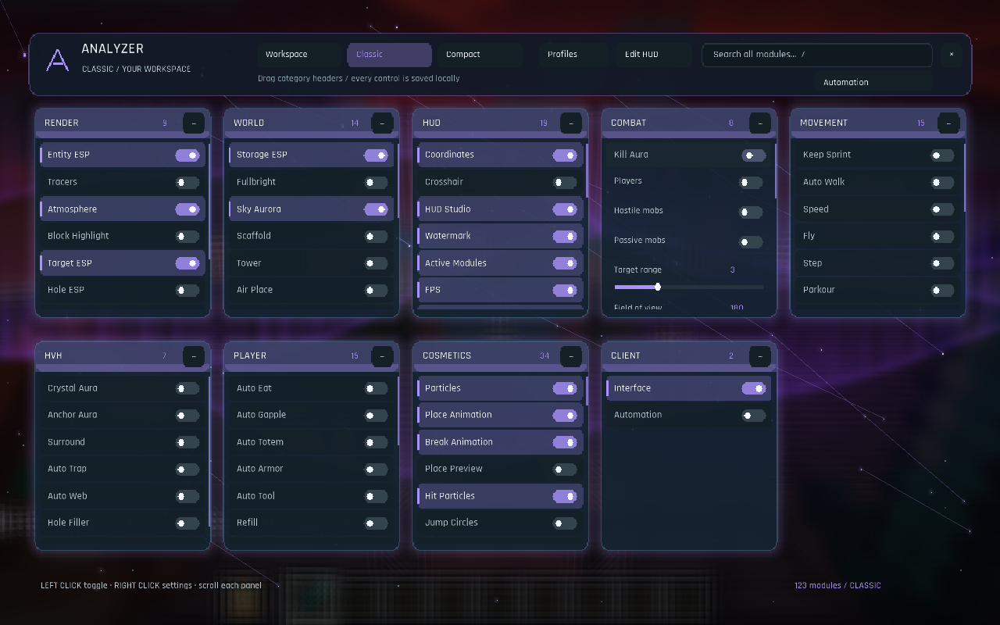

> **0.5.0:** Distance-aware, independently scaled and decluttered ESP; a local Automation task console with optional official Baritone. See [ESP readability](ESP-READABILITY.md) and [Automation](AUTOMATION.md) for settings, examples and actual scope.

# Analyzer

An original client for **Minecraft Java Edition 1.21.4**, built on **Fabric and Java 21**. Analyzer **0.5.0** has **123 registered modules**: world visuals, editable HUD widgets, three native menu layouts, combat/HvH, movement, inventory automation and building/mining utilities. Prism integration includes a local development updater.




## Install and start

**Prism Launcher:** drag `Analyzer-0.5.0-Prism-1.21.4.zip` onto Prism's main window and import it. The archive includes Analyzer, Fabric API, the official Baritone API and the Windows local updater. See [PRISM.md](PRISM.md) for installation and updates. An existing Analyzer instance connected to the project's feed updates on its next launch after Minecraft is closed; Baritone is a separate mod installed once for Automation.

For another launcher, create a **Fabric 1.21.4** instance with **Java 21**, then place both `analyzer-0.5.0.jar` and `fabric-api-0.119.4+1.21.4.jar` in its `mods/` folder. Add the separate official `baritone-api-fabric-1.13.1.jar` to run Automation. The verified loader is **0.16.14**; Analyzer requires **0.16.10 or newer**. Keep one Analyzer JAR installed. The Prism ZIP uses a checksum suffix on the Analyzer filename.

Click **Analyzer** on the title screen or press **Right Shift** in game. Choose **Profiles → cinematic → Load** for the visual/HUD setup, or **studio** to try selected new cosmetics. **classic** uses draggable category columns and **neon** uses the Compact layout and Neon HUD; these four visual profiles leave gameplay automation off. Loading **hvh** explicitly enables Kill Aura, Crystal Aura, Surround, Auto Weapon, Auto Totem, Auto Armor and Keep Sprint, with combat HUD widgets. Earlier **showcase**, **arctic**, **cinder**, **aurora**, **ember** and **minimal** profiles remain available. Profiles are available from the Workspace layout.

Profiles are seeded once without overwriting existing files. Loading a profile replaces active settings and module keybinds. Settings live in `config/analyzer/config.json`; profiles in `config/analyzer/profiles/`, friends in `config/analyzer/friends.txt`. The updater preserves these and your worlds.

## Menus and HUD

- **Workspace:** categories, search, module cards and a scrolling settings inspector. Select a card to inspect it; use its switch or **Space** to toggle it. **/** focuses search.
- **Classic:** independent draggable category columns with collapse and scroll. Left-click a module to toggle it; right-click to open its settings.
- **Compact:** searchable category/card view with a settings inspector. Left-click to select/toggle; right-click to inspect.
- Use the header's **Workspace / Classic / Compact / Edit HUD** buttons to change layout or edit the HUD. Layout selection persists.
- **Edit HUD:** drag widgets, right-click to toggle them, use arrows to move a selection, and choose grid snapping, scale and **Glass / Classic / Minimal / Neon** themes. Settings and reset controls are available in the editor. **Show active** starts with enabled widgets; **Show all** exposes disabled ones for positioning.
- Fresh HUD settings use **60% scale**. Updating preserves a saved scale and existing widget positions. To change an older setup, open **HUD Studio → HUD scale** or use the editor scale controls. New text uses the bundled Rajdhani SemiBold font, smooth sampling of its own font atlases, brighter secondary labels and alignment to physical pixels; small HUD text keeps a minimum readable size as panels shrink.
- Under **Interface**, choose **Glass / Solid**, **Mint / Violet / Gold**, and motion speed. Menu particles react to the cursor; density zero hides them and motion zero freezes movement.
- Assign a module **Keybind** in its inspector. **Backspace/Delete** clears it; **Escape** cancels. Changes save automatically.

## Implemented features

The complete IDs, settings and defaults are exported in [MODULES.md](MODULES.md) and [MODULES.json](MODULES.json).

| Group | Count | Implemented scope |
| --- | ---: | --- |
| Original visual/interface modules | 10 | Entity/Storage ESP, Tracers, Fullbright, Coordinates, Crosshair, menu particles, Interface, Atmosphere and Sky Aurora. ESP includes Boxes/Corners/Screen styles, filters, labels, health, radar and live target/scan statuses. |
| HUD and client controls | 17 | HUD Studio plus watermark, active modules, FPS, ping, speed, armor, potion effects, Target HUD, keybinds, inventory, compass, biome, world clock, item counter, keystrokes and target distance. Widgets use actual game data and saved positions. |
| World effects | 31 | Existing place/break/hit effects and overlays now have broader shape, color, timing and target controls. New Air Effects, Block Effects, Damage Effects, Contrails, Storm Effects, Vitals and Hit Sounds use actual world state/events. |
| Model and item cosmetics | 8 | Item Physics, Hand Tweaks, Crystal Chams, Cape, Pets, Emotes, Walk Style and client-model Spinbot. Original meshes and render transforms; exact controls and limits are compared in [RESEARCH-COSMETICS.md](RESEARCH-COSMETICS.md). |
| Combat and HvH | 15 | Kill Aura, Aim Assist, Trigger Bot, Auto Clicker, Auto Weapon, Shield Breaker, Bow Aimbot, Criticals; Crystal/Anchor Aura, Surround, Auto Trap, Auto Web, Hole Filler and Target Strafe. These perform ordinary attacks, item/block interactions or client movement. |
| Movement | 15 | Keep Sprint, Auto Walk, Speed, Fly, Step, Parkour, Safe Walk, Fast Ladder, Reverse Step, Fast Fall, Glide, High Jump, Long Jump, Elytra Boost and Ground Strafe. Owned input and temporary step changes are restored on disable/pause. |
| Player automation | 10 | Auto Eat/Gapple/Totem/Armor/Tool, Refill, Anti AFK, Auto Respawn, Durability Alert and Auto Fish. Normal inventory actions are guarded; Auto Armor preserves an equipped Elytra. |
| World utilities | 16 | Scaffold, Tower, Air Place, Nuker, Auto Farm, Auto Tunnel, Bed Breaker, Flatten, Speed Mine, Vein Miner, No Block Interact, Chest Stealer, Middle Click Friend, Player Detection, Notifier and Coord Snapper. Work is bounded to loaded, reachable game data. |
| Task automation | 1 | Automation reviews supported local travel, mining, crafting, starter-shelter and diamond-kit plans. Baritone performs pathfinding; ordinary inventory transactions and actual item/world checks drive stages. See [AUTOMATION.md](AUTOMATION.md) for prerequisites and limits. |

Fresh defaults enable **Sky Aurora, Interface, Particles, Coordinates, HUD Studio, Watermark, Active Modules, FPS, Place Animation, Break Animation and Hit Particles**. All combat, HvH, movement, player automation and world utilities are disabled by default. Entity/Storage ESP are opt-in, or can be enabled through a visual profile.

## Trying gameplay modules

Enable one module at a time and inspect its settings/status. Target filters default to **Players** for combat; enable **Hostile mobs** and disable Players to try a singleplayer mob arena. Persisted friends are excluded from combat targeting. Most gameplay automation pauses while a menu is open.

Melee modules need a suitable hotbar weapon and normal reach/cooldown. Shield Breaker needs an axe; Bow Aimbot needs a drawn bow. Criticals uses a real jump and falling-phase attack. Surround/Trap/Hole Filler need hotbar obsidian, Auto Web needs cobwebs, and ordinary placement needs valid support/reach. Crystal Aura needs crystals plus reachable obsidian/bedrock; Anchor Aura needs anchors, glowstone and a non-glowstone hand for detonation in a dimension where anchors explode. The Nether is excluded from detonation.

Crystal/Anchor Aura have health/distance guards but **no explosion damage prediction**. Fly/Speed and other velocity modules alter client movement; a server can correct or reject it. Air Place attempts a normal interaction and depends on server acceptance. There are no promised anticheat bypasses, silent rotations or packet criticals. Refill currently restocks low **nonempty** hotbar stacks; weapon/armor scoring uses material estimates rather than full enchantment simulation.

## Rendering scope

**Sky Aurora** draws original **Aurora / Nebula / Ember** skies and stars in the actual world sky pass before terrain/celestial objects, with intensity, speed, night-only visibility and rain attenuation. **Atmosphere** separately applies GPU bloom, grading and vignette before the HUD; **Bloom** keeps neutral colors and Aurora/Ember/Frost add color looks. Glass samples a blurred game backdrop behind translucent panels, rims and glow; it does not implement refraction.

Place/Break Animation adds animated ghost overlays and bounded debris to real local actions; the vanilla block mesh remains. Explosion and totem effects add visuals to actual game events. Player Aura draws rotating rings. Visual styles are original geometry, particles and client render hooks. A style or color option describes the scope of that module; it does not imply Temple's complete material collection. See [RESEARCH-COSMETICS.md](RESEARCH-COSMETICS.md) for the 37 cosmetic reference rows and explicit unsupported controls.

ESP uses entities and containers loaded by the game. **Boxes/Corners** use depth-tested world geometry when Through walls is off. **Screen** draws projected HUD rectangles; disabling Through walls filters by a center line-of-sight raycast, rather than masking individual HUD pixels against world depth. The radar uses selected loaded targets.

Iris is not bundled; Iris/Sodium and other renderer compatibility has not been validated. Analyzer does not add shadow maps, water reflections, volumetric clouds or a replacement world-lighting pipeline. The release is pinned to **1.21.4**; other versions need source changes and a new build.

The [roadmap](ROADMAP.md) compares all **163 Temple.nz reference modules**, distinguishing scoped counterparts, partial implementations and remaining work. HUD widgets count as one reference area. This is not a feature-parity claim. Selected runtime checks are recorded in [VALIDATION.md](VALIDATION.md); not all registered modules or their modes have been tested in game. See [RESEARCH.md](RESEARCH.md) and [RESEARCH-VISUALS.md](RESEARCH-VISUALS.md) for primary sources and sampled visual observations; [RESEARCH-COSMETICS.md](RESEARCH-COSMETICS.md) records the current control-level cosmetic comparison.

## Build from source

Select a Java 21 JDK with `JAVA_HOME`, then run:

```powershell
.\gradlew.bat build          # remapped build + core checks
.\gradlew.bat moduleCatalog  # export the actual registry
.\gradlew.bat runClient      # interactive development instance
.\gradlew.bat runSmoke       # isolated UI/world/gameplay checks
.\gradlew.bat publishLocal   # publish to the Prism local update feed
```

On macOS/Linux use `./gradlew` in place of `.\gradlew.bat`. The wrapper downloads Gradle 8.12 and checks its SHA-256; Loom fetches pinned official Minecraft/Yarn/Fabric dependencies. The installable artifact is `build/libs/analyzer-0.5.0.jar`.

`runSmoke` uses the project-local `run/` directory, creates/updates only `run/saves/Analyzer-Smoke`, captures screenshots, and exits. Installed release builds never activate the development harness. See VALIDATION for assertions and results. Optional pixel checks use `python tools/verify_render.py` and `python tools/verify_visuals.py` with Pillow.

Source packages are `core/` for definitions/configuration, `ui/` for native screens/HUD, `render/` for overlays/event effects, `effects/` for original GLSL/state restoration, `gameplay/` for bounded game actions, and `mixin/` for narrow 1.21.4 hooks.

Analyzer code is MIT licensed. No client source from GPL projects was copied. Rajdhani fonts use the SIL Open Font License; see [THIRD-PARTY.md](THIRD-PARTY.md), `FONT-LICENSE.txt` and `GRADLE-LICENSE.txt`.

