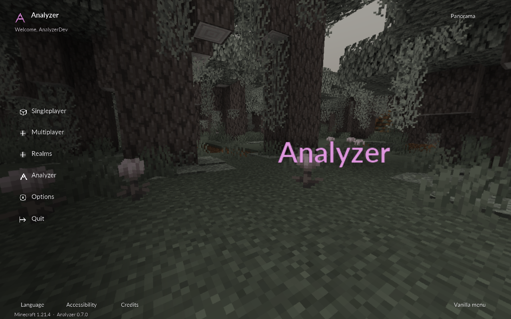

> **0.7.0 Home screen:** Minecraft panorama is the default, with an optional original Orbit shader. Left navigation opens real world/server lists and Minecraft Options in translucent panels. Home preferences live in **HUD Studio**; the vanilla menu remains available. See [Home controls and native captures](HOME-SCREEN.md), [the preceding 123-module sweep](MODULE-TESTS.md) and [current validation/delivery status](VALIDATION.md).

# Analyzer

An original client for **Minecraft Java Edition 1.21.4**, built on **Fabric and Java 21**. Analyzer **0.7.0** has **123 registered modules**: world visuals, editable HUD widgets, a custom Home screen, four native module menus, combat/HvH, movement, inventory automation and building/mining utilities. Prism integration includes a local development updater.



## Install and start

**Prism Launcher:** drag `Analyzer-0.7.0-Prism-1.21.4.zip` onto Prism's main window and import it. The archive includes Analyzer, Fabric API, the official Baritone API and the Windows local updater. See [PRISM.md](PRISM.md) for installation and updates. An existing Analyzer instance connected to the project's feed updates on its next launch after Minecraft is closed; Baritone is a separate mod installed once for Automation.

Project updates also rebuild the Prism ZIP and update the user's local Analyzer instance. The standing delivery workflow is recorded in [AGENTS.md](AGENTS.md).

For another launcher, create a **Fabric 1.21.4** instance with **Java 21**, then place both `analyzer-0.7.0.jar` and `fabric-api-0.119.4+1.21.4.jar` in its `mods/` folder. Add the separate official `baritone-api-fabric-1.13.1.jar` to run Automation. The verified loader is **0.16.14**; Analyzer requires **0.16.10 or newer**. Keep one Analyzer JAR installed. The Prism ZIP uses a checksum suffix on the Analyzer filename.

The custom Home screen opens by default over Minecraft's panorama. Use its top-right button to switch to Orbit; **Vanilla menu** saves the original title preference. [Home controls](HOME-SCREEN.md) describes the real world/server and options pages. Click **Analyzer** on Home or the vanilla title screen or press **Right Shift** in game. Fresh installs open **Studio** with the **Rose** accent; choose **HUD Studio → Menu layout → Studio** to switch an existing preference. **Profiles → studio → Load** adds selected cosmetics and Studio appearance; **cinematic** retains Workspace, **classic** uses draggable category columns and **neon** uses Compact and Neon HUD. These four visual profiles leave gameplay automation off. Loading **hvh** explicitly enables Kill Aura, Crystal Aura, Surround, Auto Weapon, Auto Totem, Auto Armor and Keep Sprint, with combat HUD widgets. Earlier **showcase**, **arctic**, **cinder**, **aurora**, **ember** and **minimal** profiles remain available. Profiles opens from every menu; Back restores the parent catalogue context.

Profiles are seeded once without overwriting existing files. An older saved profile can restore an older menu preference; use HUD Studio's appearance controls to select Studio again without replacing other settings. Loading a profile replaces active settings and module keybinds. Settings live in `config/analyzer/config.json`; profiles in `config/analyzer/profiles/`, friends in `config/analyzer/friends.txt`. The updater preserves these and your worlds.

## Menus and HUD

- **Studio:** a centered black-and-charcoal shell, top category tabs, three columns of rounded cards and settings that expand inside each card. A card's switch enables/disables the module separately. Expanded cards scroll their long settings; the catalogue scrolls separately. GLSL draws smooth surfaces, shadows, pills and glow; the bundled Lato Regular/Bold font gives this menu a wider typeface.
- **Workspace:** the retained sidebar, search, two-column cards and scrolling inspector. Click a card to inspect; its separate switch enables/disables it. **/** focuses search.
- **Classic:** independent draggable category columns with collapse and scroll. Click a module row to inspect its inline settings; use its separate switch to toggle it. Right-click also opens/closes inspection.
- **Compact:** a denser searchable category/card view and separate inspector. Click a card to inspect it; use its separate switch to toggle it.
- **HUD Studio** exposes **Menu layout → Studio / Workspace / Classic / Compact**, **Panel material → Glass / Solid**, **Menu theme → Glass / Classic / Minimal / Neon**, and **Accent colour → Rose / Mint / Violet / Gold**. These share Interface's saved preferences; they are not conflicting copies. The **Appearance** action in Studio, legacy menu shortcuts and the HUD editor open these controls. Layout selection persists.
- **Edit HUD:** drag widgets, right-click to toggle them, use arrows to move a selection, and choose grid snapping, scale and **Glass / Classic / Minimal / Neon** themes. Settings and reset controls are available in the editor. **Show active** starts with enabled widgets; **Show all** exposes disabled ones for positioning.
- Fresh HUD settings use **60% scale**. Updating preserves a saved scale and existing widget positions. To change an older setup, open **HUD Studio → HUD scale** or use the editor scale controls. HUD text keeps the bundled Rajdhani SemiBold font, smooth own-font sampling and a readable minimum size as panels shrink; Studio uses separate Lato font resources.
- Menu theme and HUD theme are independent. Glass material uses actual scene frost behind translucent panels; Solid gives Studio the reference's black-and-charcoal appearance. The Glass theme and Glass material are separate controls. Under **Interface**, motion zero freezes menu movement. Studio keeps ambient particle networks out of its content; the Particles module remains available in legacy menus.
- Assign a module **Keybind** in its expanded Studio card or legacy inspector. **Backspace/Delete** clears it; **Escape** cancels. Changes save automatically.
- Expanded cards and legacy inspectors group related settings and wrap labels; fields for inactive modes keep their saved values. Click a numeric value or **right-click its slider row** to type a precise value, then press Enter or Apply. **Tab / Shift+Tab** moves visible focus, **Enter / Space** activates the focused control, arrow keys adjust supported values, and **Page Up / Down** scrolls settings. Shared catalogue controls provide labels through Minecraft's native narration hook. See [Gameplay settings](GAMEPLAY-SETTINGS.md) for behavior and reference gaps.
- Returning from **Profiles**, **Edit HUD** or **Automation** restores the parent screen's search/category/selection context. Loading a profile remains an explicit replacement of module settings and keybinds.

The latest direction in the [reference board](UI-REFERENCES.md) replaces the earlier Focused workspace choice: reference 3's black/gray cards, top navigation, inline settings and pink controls now define Studio. Previous Workspace captures and the browser comparison remain historical evidence. The native catalogue exposes **1,099 controls: 1,091 canonical settings plus eight HUD Studio appearance/Home aliases**. [UI-OVERHAUL.md](UI-OVERHAUL.md) records current controls and screenshots; [UI-OVERHAUL-PLAN.md](UI-OVERHAUL-PLAN.md) keeps the acceptance requirements and verification scope.

## Implemented features

The complete IDs, settings and defaults are exported in [MODULES.md](MODULES.md) and [MODULES.json](MODULES.json).

| Group | Count | Implemented scope |
| --- | ---: | --- |
| Original visual/interface modules | 10 | Entity/Storage ESP, Tracers, Fullbright, Coordinates, Crosshair, menu particles, Interface, Atmosphere and Sky Aurora. ESP includes Boxes/Corners/Screen styles, filters, labels, health, radar and live target/scan statuses. |
| HUD and client controls | 17 | HUD Studio plus watermark, active modules, FPS, ping, speed, armor, potion effects, Target HUD, keybinds, inventory, compass, biome, world clock, item counter, keystrokes and target distance. Widgets use actual game data and saved positions. |
| World effects | 31 | Existing place/break/hit effects and overlays now have broader shape, color, timing and target controls. New Air Effects, Block Effects, Damage Effects, Contrails, Storm Effects, Vitals and Hit Sounds use actual world state/events. |
| Model and item cosmetics | 8 | Item Physics, Hand Tweaks, Crystal Chams, Cape, Pets, Emotes, Walk Style and client-model Spinbot. Original meshes and render transforms; exact controls and limits are compared in [RESEARCH-COSMETICS.md](RESEARCH-COSMETICS.md). |
| Combat and HvH | 15 | Kill Aura, Aim Assist, Trigger Bot, Auto Clicker, Auto Weapon, Shield Breaker, Bow Aimbot, Criticals; Crystal/Anchor Aura, Surround, Auto Trap, Auto Web, Hole Filler and Target Strafe. These perform ordinary attacks, item/block interactions or client movement. |
| Movement | 15 | Keep Sprint, Auto Walk, Speed, Fly, Step, Parkour, Safe Walk, Fast Ladder, Reverse Step, Fast Fall, Glide, High Jump, Long Jump, Elytra Boost and Ground Strafe. Owned input and temporary step changes are restored on disable/pause. |
| Player automation | 10 | Auto Eat/Gapple/Totem/Armor/Tool, Refill, Anti AFK, Auto Respawn, Durability Alert and Auto Fish. Normal inventory actions are guarded; Auto Armor preserves an equipped Elytra. |
| World utilities | 16 | Scaffold, Tower, Air Place, Nuker, Auto Farm, Auto Tunnel, Bed Breaker, Flatten, Speed Mine, Vein Miner, No Block Interact, Chest Stealer, Middle Click Friend, Player Detection, Notifier and Coord Snapper. Work is bounded to loaded, reachable game data. |
| Task automation | 1 | Automation reviews supported local travel, mining, crafting, starter-shelter and diamond-kit plans. Baritone performs pathfinding; normal inventory actions and actual game-state checks drive stages. Scoped safer routes, PvE protection, short retreat and available-food consumption apply only to explicitly started Analyzer tasks. See [AUTOMATION.md](AUTOMATION.md) and [SAFETY.md](SAFETY.md). |

Fresh defaults enable **Sky Aurora, Interface, Particles, Coordinates, HUD Studio, Watermark, Active Modules, FPS, Place Animation, Break Animation and Hit Particles**. All combat, HvH, movement, player automation and world utilities are disabled by default. Entity/Storage ESP are opt-in, or can be enabled through a visual profile.

## Automation protection

Start through **Right Shift → Automation → Review plan → Start reviewed plan**. With fresh settings, the task uses safer Baritone route settings, watches nearby hostile mobs within 12 blocks, eats suitable available food below 14 hunger, and prefers retreat when health is low or an urgent creeper threatens it. Creepers that are ignited, swelling or close receive priority over ordinary pursuers; nearby creepers can remain threats without a clear line of sight. Ordinary attacks respect reach and cooldowns. Protection pauses the original task and shows **TASK PAUSED FOR SAFETY**; after the three-second quiet delay it checks the configured retreat/minimum-health and minimum-hunger limits before resuming.

An unavailable retreat or recovery enters a live **SAFETY_HOLD**: mining stays paused while protection rechecks threats, terrain and available food. Short escape checks cover up to two loaded blocks, using collision shapes for snow/slabs, one-block steps and drops, and surface water with a clear route to air. Explosion knockback or a changed shoreline can therefore be re-evaluated. A stage already blocked for another requirement returns to that requirement after protection clears; it does not restart automatically.

The temporary route settings restore on user Pause, Stop, completion, ordinary task blocking, disconnect/death or manual Baritone takeover. User Pause and Stop release owned movement/use inputs. Protection remains bounded: it does not plan long routes to cover, navigate deep or enclosed water, climb, fly or fight players. Missing food, trapped terrain and dangerous combat may still require manual recovery. Read [SAFETY.md](SAFETY.md) for the exact controls and limits.

## Trying gameplay modules

Enable one module at a time and inspect its settings/status. Target filters default to **Players** for combat; enable **Hostile mobs** and disable Players to try a singleplayer mob arena. Persisted friends are excluded by the default Ignore friends setting. Most gameplay automation pauses while a menu is open.

Melee modules need a suitable hotbar weapon and normal reach/cooldown. Shield Breaker needs an axe; Bow Aimbot supports selected bow/crossbow/trident inputs. Criticals uses real jumping/falling attacks. Surround/Trap/Hole Filler need the selected hotbar building material, Auto Web needs cobwebs, and ordinary placement needs valid support/reach. Crystal Aura needs crystals plus reachable obsidian/bedrock; Anchor Aura needs anchors, glowstone and a non-glowstone hand for detonation in a dimension where anchors explode. The Nether is excluded from detonation.

Crystal/Anchor Aura now combine health/distance guards with loaded-terrain explosion estimates, enemy/self damage limits and friend protection. Self estimates omit protective enchantment/effect reductions; estimates can differ from server outcomes. Fly/Speed offer direct motion and applicable normal-input modes; a server can correct or reject direct motion. Air Place attempts a normal interaction and depends on server acceptance. There are no promised anticheat bypasses, silent rotations or packet criticals. Refill currently restocks low **nonempty** hotbar stacks; weapon/armor scoring uses material estimates rather than full enchantment simulation. The [gameplay settings overhaul](GAMEPLAY-SETTINGS.md) records all implemented behavior and limits.

## Rendering scope

**Sky Aurora** draws original **Aurora / Nebula / Ember** skies and stars in the actual world sky pass before terrain/celestial objects, with intensity, speed, night-only visibility and rain attenuation. **Atmosphere** separately applies GPU bloom, grading and vignette before the HUD; **Bloom** keeps neutral colors and Aurora/Ember/Frost add color looks. Glass samples a blurred game backdrop behind translucent panels, rims and glow; it does not implement refraction.

Place/Break Animation adds animated ghost overlays and bounded debris to real local actions; the vanilla block mesh remains. Explosion and totem effects add visuals to actual game events. Player Aura draws rotating rings. Visual styles are original geometry, particles and client render hooks. A style or color option describes the scope of that module; it does not imply Temple's complete material collection. See [RESEARCH-COSMETICS.md](RESEARCH-COSMETICS.md) for the 37 cosmetic reference rows and explicit unsupported controls.

ESP uses entities and containers loaded by the game. **Boxes/Corners** use depth-tested world geometry when Through walls is off. **Screen** draws projected HUD rectangles; disabling Through walls filters by a center line-of-sight raycast, rather than masking individual HUD pixels against world depth. The radar uses selected loaded targets.

Iris is not bundled; Iris/Sodium and other renderer compatibility has not been validated. Analyzer does not add shadow maps, water reflections, volumetric clouds or a replacement world-lighting pipeline. The release is pinned to **1.21.4**; other versions need source changes and a new build.

The [roadmap](ROADMAP.md) compares all **163 Temple.nz reference modules**, distinguishing scoped counterparts, partial implementations and remaining work. HUD widgets count as one reference area. This is not a feature-parity claim. Selected runtime checks are recorded in [VALIDATION.md](VALIDATION.md); not all registered modules or their modes have been tested in game. See [RESEARCH.md](RESEARCH.md) and [RESEARCH-VISUALS.md](RESEARCH-VISUALS.md) for primary sources and sampled visual observations; [RESEARCH-COSMETICS.md](RESEARCH-COSMETICS.md) records the current control-level cosmetic comparison.

## Build from source

Private source and versioned downloads: [XonistReal/Analyzer](https://github.com/XonistReal/Analyzer). See [Moving PCs](MOVING-PCS.md) for cloning, Prism import and reconnecting the local updater.

Select a Java 21 JDK with `JAVA_HOME`, then run:

```powershell
.\gradlew.bat build          # remapped build + core checks
.\gradlew.bat moduleCatalog  # export the actual registry
.\gradlew.bat runClient      # interactive development instance
.\gradlew.bat runStudioSmoke # focused native GLSL Studio acceptance
.\gradlew.bat runSmoke       # isolated UI/world/gameplay checks
.\gradlew.bat runGameplaySmoke # focused gameplay settings and numeric-entry checks
.\gradlew.bat publishLocal   # publish to the Prism local update feed
```

On macOS/Linux use `./gradlew` in place of `.\gradlew.bat`. The wrapper downloads Gradle 8.12 and checks its SHA-256; Loom fetches pinned official Minecraft/Yarn/Fabric dependencies. The installable artifact is `build/libs/analyzer-0.7.0.jar`.

`runSmoke` uses the project-local `run/` directory, creates/updates only `run/saves/Analyzer-Smoke`, captures screenshots, and exits. Installed release builds never activate the development harness. See VALIDATION for assertions and results. Optional pixel checks use `python tools/verify_render.py` and `python tools/verify_visuals.py` with Pillow.

Source packages are `core/` for definitions/configuration, `ui/` for native screens/HUD, `render/` for overlays/event effects, `effects/` for original GLSL/state restoration, `gameplay/` for bounded game actions, `automation/` for the task planner, scoped Baritone bridge, inventory stages and Survival guard, and `mixin/` for narrow 1.21.4 hooks.

Analyzer code is MIT licensed. No client source from GPL projects was copied. Lato for Studio and Rajdhani for retained menus/HUD use the SIL Open Font License; see [THIRD-PARTY.md](THIRD-PARTY.md), [LATO-OFL.txt](LATO-OFL.txt), `FONT-LICENSE.txt` and `GRADLE-LICENSE.txt`.
