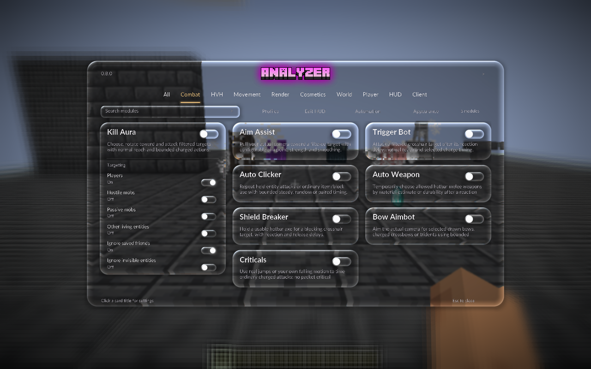

> **0.10.0 Native Automation:** Analyzer now owns task planning, pathfinding, smooth movement, mining, schematic construction, inventory work and mob protection. Baritone is no longer a runtime dependency. See [automation and its limits](AUTOMATION.md) and [observed acceptance](VALIDATION.md). Server Privacy, Studio / Click GUI and liquid Glass remain available.

# Analyzer

An original client for **Minecraft Java Edition 1.21.4**, built on **Fabric and Java 21**. Analyzer **0.10.0** has **124 registered modules**: server privacy, world visuals, editable HUD widgets, a custom Home screen, two native shader module menus, combat/HvH, movement, inventory automation and building/mining utilities. Prism integration includes a local development updater.



## Install and start

**Prism Launcher:** drag `Analyzer-0.10.0-Prism-1.21.4.zip` onto Prism's main window and import it. The archive includes Analyzer, Fabric API, and the Windows local updater. See [PRISM.md](PRISM.md) for installation and updates. An existing Analyzer instance connected to the project's feed updates on its next launch after Minecraft is closed; native Automation is included in Analyzer.

Project updates also rebuild the Prism ZIP and update the user's local Analyzer instance. The standing delivery workflow is recorded in [AGENTS.md](AGENTS.md).

For another launcher, create a **Fabric 1.21.4** instance with **Java 21**, then place both `analyzer-0.10.0.jar` and `fabric-api-0.119.4+1.21.4.jar` in its `mods/` folder. The verified loader is **0.16.14**; Analyzer requires **0.16.10 or newer**. Keep one Analyzer JAR installed. The Prism ZIP uses a checksum suffix on the Analyzer filename.

The custom Home screen opens by default over Minecraft's panorama. Use its top-right button to switch to Orbit; **Vanilla menu** saves the original title preference. [Home controls](HOME-SCREEN.md) describes the real world/server and options pages. Click **Modules** on Home or **Analyzer** on the vanilla title screen or press **Right Shift** in game. Fresh installs open **Studio** with the **Rose** accent; choose **HUD Studio → Menu layout → Studio** to switch an existing preference. **Profiles → studio → Load** adds selected cosmetics and Studio appearance; **cinematic**, **classic** and **neon** also open Studio while retaining their distinct visual settings and HUD themes. These four visual profiles leave gameplay automation off. Loading **hvh** explicitly enables Kill Aura, Crystal Aura, Surround, Auto Weapon, Auto Totem, Auto Armor and Keep Sprint, with combat HUD widgets. Earlier **showcase**, **arctic**, **cinder**, **aurora**, **ember** and **minimal** profiles remain available. Profiles opens from every menu; Back restores the parent catalogue context.

Profiles are seeded once without overwriting existing files. Workspace, Classic and Compact layout values in an older config or profile migrate to Studio when loaded. This changes only the active layout value; source profile bytes and all unrelated settings remain intact. Back to modules therefore cannot reopen a retired layout. Loading a profile replaces active settings and module keybinds. Settings live in `config/analyzer/config.json`; profiles in `config/analyzer/profiles/`, friends in `config/analyzer/friends.txt`. The updater preserves these and your worlds.

## Menus and HUD

**Watermark → Logo** selects **Analyzer logo** (default) or **A logo**. Gameplay and the HUD editor show one supplied image at a time. The choice saves with your settings and profiles; placement, scale, opacity and version caption are retained.

- **Studio:** a centered black-and-charcoal shell, top category tabs, three columns of rounded cards and settings that expand inside each card. A card's switch enables/disables the module separately. Expanded cards scroll their long settings; the catalogue scrolls separately. GLSL draws smooth surfaces, shadows, pills and glow; the bundled Lato Regular/Bold font gives this menu a wider typeface.
- **Click GUI:** the new shader category-column board. Category buttons reveal their columns; drag a header to reposition it and right-click to collapse it. Scroll individual module/settings columns or use the horizontal rail to reach the board. Module titles inspect settings independently of their switches. It shares Studio's Lato font, shader controls and auxiliary screens.
- **HUD Studio** exposes **Menu layout → Studio / Click GUI**, **Menu material → Glass / Solid**, **Menu theme → Glass / Classic / Minimal / Neon**, and **Accent colour → Rose / Mint / Violet / Gold**. These alias Interface's canonical saved preferences. Studio's **Appearance** action, Click GUI's **Style** action and the HUD editor open these controls. Workspace, Classic and Compact are removed layouts; **Classic** remains a theme.
- **Edit HUD:** drag widgets, right-click to toggle them, use arrows to move a selection, and choose grid snapping, scale and **Glass / Classic / Minimal / Neon** themes. Settings and reset controls are available in the editor. **Show active** starts with enabled widgets; **Show all** exposes disabled ones for positioning.
- Fresh HUD settings use **60% scale**. Updating preserves a saved scale and existing widget positions. To change an older setup, open **HUD Studio → HUD scale** or use the editor scale controls. HUD text now uses Lato with a readable minimum size as panels shrink; its panels, slots, keycaps and bars use Studio's native shader surfaces. Radar and protection notices share the new HUD surface.
- Menu theme and HUD theme are independent. **Glass theme** uses original liquid-glass GLSL: a captured scene refracts through curved surfaces, with lightly frosted interiors, subtle color dispersion and directional edge highlights. **Menu material** controls background softness and the outer shell: Glass softens the background, while Solid keeps it crisp. Glass-theme cards and controls retain refraction with Solid material. Under **Interface**, motion zero freezes menu movement. See [optics and verification](LIQUID-GLASS.md).
- Assign a module **Keybind** in its expanded Studio card or Click GUI settings. **Backspace/Delete** clears it; **Escape** cancels. Changes save automatically.
- Expanded cards and Click GUI settings group related settings and wrap labels; fields for inactive modes keep their saved values. Click a numeric value or **right-click its slider row** to type a precise value, then press Enter or Apply. **Tab / Shift+Tab** moves visible focus, **Enter / Space** activates the focused control, arrow keys adjust supported values, and **Page Up / Down** scrolls settings. Shared catalogue controls provide labels through Minecraft's native narration hook. See [Gameplay settings](GAMEPLAY-SETTINGS.md) for behavior and reference gaps.
- Returning from **Profiles**, **Edit HUD** or **Automation** restores the parent screen's search/category/selection context. Loading a profile remains an explicit replacement of module settings and keybinds.

The [complete Studio refresh](STUDIO-COMPLETE.md) extends that presentation to Profiles, Automation, numeric entry and HUD editing, using only current shader layouts. The current direction keeps reference 3's black/gray cards, top navigation, inline settings and pink controls in Studio, and adds the new shader Click GUI. The earlier [reference board](UI-REFERENCES.md) records the historical comparisons. Previous Workspace captures and the browser comparison remain historical evidence. The native catalogue exposes **1,124 controls: 1,116 canonical settings plus eight HUD Studio appearance/Home aliases**. [STUDIO-COMPLETE.md](STUDIO-COMPLETE.md) records the original refresh controls and screenshots; [UI-OVERHAUL.md](UI-OVERHAUL.md) retains earlier history; [UI-OVERHAUL-PLAN.md](UI-OVERHAUL-PLAN.md) keeps the acceptance requirements and verification scope.

Server Privacy defaults on for fresh and older configs. Strict mode limits custom channels and can disable mods that require server networking; compatibility switches are explicit. It reduces tested information leaks, without claiming that gameplay behavior is invisible. Saved opt-outs, profiles and other preferences remain independent. [SERVER-PRIVACY.md](SERVER-PRIVACY.md) explains each of the eight protections and their limits.

## Implemented features

The complete IDs, settings and defaults are exported in [MODULES.md](MODULES.md) and [MODULES.json](MODULES.json).

| Group | Count | Implemented scope |
| --- | ---: | --- |
| Original visual/interface modules | 10 | Entity/Storage ESP, Tracers, Fullbright, Coordinates, Crosshair, menu particles, Interface, Atmosphere and Sky Aurora. ESP includes Boxes/Corners/Screen styles, filters, labels, health, radar and live target/scan statuses. |
| HUD and client controls | 17 | HUD Studio plus watermark, active modules, FPS, ping, speed, armor, potion effects, Target HUD, keybinds, inventory, compass, biome, world clock, item counter, keystrokes and target distance. Widgets use actual game data and saved positions. |
| World effects | 31 | Existing place/break/hit effects and overlays now have broader shape, color, timing and target controls. New Air Effects, Block Effects, Damage Effects, Contrails, Storm Effects, Vitals and Hit Sounds use actual world state/events. |
| Model and item cosmetics | 8 | Item Physics, Hand Tweaks, Crystal Chams, Cape, Pets, Emotes, Walk Style and client-model Spinbot. Original meshes and render transforms; exact controls and limits are compared in [RESEARCH-COSMETICS.md](RESEARCH-COSMETICS.md). |
| Combat and HvH | 15 | Kill Aura, Aim Assist, Trigger Bot, Auto Clicker, Auto Weapon, Shield Breaker, Bow Aimbot, Criticals; Crystal/Anchor Aura, Surround, Auto Trap, Auto Web, Hole Filler and Target Strafe. These perform ordinary attacks, item/block interactions or client movement. |
| Movement | 15 | Keep Sprint, Auto Walk, Speed, Fly, Step, Parkour, Safe Walk, Fast Ladder, Reverse Step, Fast Fall, Glide, High Jump, Long Jump, Elytra Boost and Ground Strafe. Owned input and temporary step changes are restored on disable/pause. |
| Player automation | 10 | Auto Eat/Gapple/Totem/Armor/Tool, Refill, Anti AFK, Auto Respawn, Durability Alert and Auto Fish. Normal inventory actions are guarded; Auto Armor preserves an equipped Elytra. |
| World utilities | 16 | Scaffold, Tower, Air Place, Nuker, Auto Farm, Auto Tunnel, Bed Breaker, Flatten, Speed Mine, Vein Miner, No Block Interact, Chest Stealer, Middle Click Friend, Player Detection, Notifier and Coord Snapper. Work is bounded to loaded, reachable game data. |
| Task automation | 1 | Automation reviews local travel, mining, material-first imported schematics, tool recovery, gear and real portal plans. Analyzer performs original native pathfinding; normal inventory actions and actual game-state checks drive stages. Safer routes, proactive hostile avoidance, bounded routes to cover and available-food consumption apply to explicitly started Analyzer tasks. See [AUTOMATION.md](AUTOMATION.md) and [SAFETY.md](SAFETY.md). |

Fresh defaults enable **Sky Aurora, Interface, Particles, Coordinates, HUD Studio, Watermark, Active Modules, FPS, Place Animation, Break Animation and Hit Particles**. All combat, HvH, movement, player automation and world utilities are disabled by default. Entity/Storage ESP are opt-in, or can be enabled through a visual profile.

## Automation protection

Start through **Right Shift → Automation → Review plan → Start reviewed plan**. Fresh settings use cautious native routes, proactively avoid hostile mobs within 16 blocks, eat suitable available food below 14 hunger, and prefer retreat when health is low or an urgent creeper threatens the player. Creepers that are ignited, swelling or close receive priority; occluded hostile mobs can remain threats. Ordinary attacks require actual aligned view, reach and cooldown. Protection pauses the original task and shows **TASK PAUSED FOR SAFETY**; after the three-second quiet delay it checks the configured recovery limits before resuming.

An unavailable retreat or recovery enters a live **SAFETY_HOLD** while protection rechecks threats, terrain and available food. A bounded local search considers loaded routes within the selected escape radius, hostile motion, line of sight and cover. Each movement segment rechecks collision shapes, steps, drops and surface water with a route to air. Urgent creeper retreat can back away while turning. A stage already blocked for another requirement returns to that requirement after protection clears.

User Pause and Stop release owned movement/use inputs. Completion, task blocking, disconnect/death and manual input takeover also release the corresponding controller state. Protection remains bounded to loaded local terrain; it does not navigate deep or enclosed water, climb, fly or fight players. Missing food, trapped terrain and dangerous combat may require manual recovery. Read [SAFETY.md](SAFETY.md) for the exact controls and limits.

## Trying gameplay modules

Enable one module at a time and inspect its settings/status. Target filters default to **Players** for combat; enable **Hostile mobs** and disable Players to try a singleplayer mob arena. Persisted friends are excluded by the default Ignore friends setting. Most gameplay automation pauses while a menu is open.

Melee modules need a suitable hotbar weapon and normal reach/cooldown. Shield Breaker needs an axe; Bow Aimbot supports selected bow/crossbow/trident inputs. Criticals uses real jumping/falling attacks. Surround/Trap/Hole Filler need the selected hotbar building material, Auto Web needs cobwebs, and ordinary placement needs valid support/reach. Crystal Aura needs crystals plus reachable obsidian/bedrock; Anchor Aura needs anchors, glowstone and a non-glowstone hand for detonation in a dimension where anchors explode. The Nether is excluded from detonation.

Crystal/Anchor Aura now combine health/distance guards with loaded-terrain explosion estimates, enemy/self damage limits and friend protection. Self estimates omit protective enchantment/effect reductions; estimates can differ from server outcomes. Fly/Speed offer direct motion and applicable normal-input modes; a server can correct or reject direct motion. Air Place attempts a normal interaction and depends on server acceptance. There are no promised anticheat bypasses, silent rotations or packet criticals. Refill currently restocks low **nonempty** hotbar stacks; weapon/armor scoring uses material estimates rather than full enchantment simulation. The [gameplay settings overhaul](GAMEPLAY-SETTINGS.md) records all implemented behavior and limits.

## Rendering scope

**Sky Aurora** draws original **Aurora / Nebula / Ember** skies and stars in the actual world sky pass before terrain/celestial objects, with intensity, speed, night-only visibility and rain attenuation. **Atmosphere** separately applies GPU bloom, grading and vignette before the HUD; **Bloom** keeps neutral colors and Aurora/Ember/Frost add color looks. Glass-theme surfaces use a separate captured scene for real refraction, curved edge displacement, frost and highlights. Menu material remains the separate background-softness control.

Place/Break Animation adds animated ghost overlays and bounded debris to real local actions; the vanilla block mesh remains. Explosion and totem effects add visuals to actual game events. Player Aura draws rotating rings. Visual styles are original geometry, particles and client render hooks. A style or color option describes the scope of that module; it does not imply Temple's complete material collection. See [RESEARCH-COSMETICS.md](RESEARCH-COSMETICS.md) for the 37 cosmetic reference rows and explicit unsupported controls.

ESP uses entities and containers loaded by the game. **Boxes/Corners** use depth-tested world geometry when Through walls is off. **Screen** draws projected HUD rectangles; disabling Through walls filters by a center line-of-sight raycast, rather than masking individual HUD pixels against world depth. The radar uses selected loaded targets.

Iris is not bundled; Iris/Sodium and other renderer compatibility has not been validated. Analyzer does not add shadow maps, water reflections, volumetric clouds or a replacement world-lighting pipeline. The release is pinned to **1.21.4**; other versions need source changes and a new build.

The [roadmap](ROADMAP.md) compares all **163 Temple.nz reference modules**, distinguishing scoped counterparts, partial implementations and remaining work. HUD widgets count as one reference area. This is not a feature-parity claim. Selected runtime checks are recorded in [VALIDATION.md](VALIDATION.md); not all registered modules or their modes have been tested in game. See [RESEARCH.md](RESEARCH.md) and [RESEARCH-VISUALS.md](RESEARCH-VISUALS.md) for primary sources and sampled visual observations; [RESEARCH-COSMETICS.md](RESEARCH-COSMETICS.md) records the current control-level cosmetic comparison.

## Build from source

Private source and versioned downloads: [XonistReal/Analyzer](https://github.com/XonistReal/Analyzer). See [Moving PCs](MOVING-PCS.md) for cloning, Prism import and reconnecting the local updater.

Select a Java 21 JDK with `JAVA_HOME`, then run:

```powershell
.\gradlew.bat build          # remapped build + core checks
.\gradlew.bat moduleCatalog  # export the actual registry
.\gradlew.bat runClient      # interactive development instance
.\gradlew.bat runStudioSmoke # focused native GLSL Studio acceptance
.\gradlew.bat runSmoke       # isolated UI/world/gameplay checks
.\gradlew.bat runGameplaySmoke # focused gameplay settings and numeric-entry checks
.\gradlew.bat runNativeAutomationSmoke # isolated native Survival acceptance, without Baritone
.\gradlew.bat publishLocal   # publish to the Prism local update feed
```

On macOS/Linux use `./gradlew` in place of `.\gradlew.bat`. The wrapper downloads Gradle 8.12 and checks its SHA-256; Loom fetches pinned official Minecraft/Yarn/Fabric dependencies. The installable artifact is `build/libs/analyzer-0.10.0.jar`.

`runSmoke` uses the project-local `run/` directory, creates/updates only `run/saves/Analyzer-Smoke`, captures screenshots, and exits. Installed release builds never activate the development harness. See VALIDATION for assertions and results. Optional pixel checks use `python tools/verify_render.py` and `python tools/verify_visuals.py` with Pillow.

Source packages are `core/` for definitions/configuration, `ui/` for native screens/HUD, `render/` for overlays/event effects, `effects/` for original GLSL/state restoration, `gameplay/` for bounded game actions, `automation/` for the task planner, original native navigation, inventory stages and Survival guard, and `mixin/` for narrow 1.21.4 hooks.

Analyzer code is MIT licensed. No client source from GPL projects was copied. Lato used by the current shader menus/HUD and the retained Rajdhani font resource use the SIL Open Font License; see [THIRD-PARTY.md](THIRD-PARTY.md), [LATO-OFL.txt](LATO-OFL.txt), `FONT-LICENSE.txt` and `GRADLE-LICENSE.txt`.
