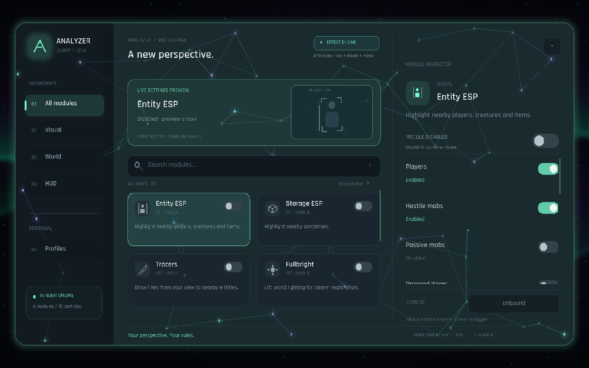

# Analyzer

An original visual utility client for **Minecraft Java Edition 1.21.4**, built on Fabric and Java 21. Analyzer **0.2.0** adds a real animated sky, a richer interface, cursor-reactive menu particles, screen ESP and a nearby-target radar. Prism integration includes a local development updater.



## Install

**Prism Launcher:** import `Analyzer-0.2.0-Prism-1.21.4.zip`. It includes both mods and the Windows local updater. See [PRISM.md](PRISM.md) for drag and drop, updates and the development workflow.

1. Create a **Minecraft 1.21.4 Fabric** instance using the [official Fabric installer](https://fabricmc.net/use/installer/) or your launcher's Fabric instance option. Use Fabric Loader **0.16.10 or newer**; the verified build uses **0.16.14**.
2. Copy **both JARs** into that instance's `mods/` folder: `analyzer-0.2.0.jar` and `fabric-api-0.119.4+1.21.4.jar`. The Prism ZIP keeps them under `minecraft/mods/` and adds a hash suffix to the Analyzer filename. Keep one Analyzer JAR installed.
3. Launch that instance. Click **Analyzer** on the title screen, or press **Right Shift** while playing.

Minecraft 1.21.4 uses Java 21. The official Minecraft Launcher supplies its game runtime. For an alternative launcher, select its Java 21 runtime. Analyzer does not replace the Minecraft launcher and does not require an account of its own.

## What's implemented

| Feature | Controls and behavior |
| --- | --- |
| Interface | Search, categories, module cards, live previews/statuses and a scrolling inspector. **Glass/Solid** panels, **Mint/Violet/Gold** accents and adjustable motion, with Rajdhani typography, animated controls and a scalable layout. |
| Particles | Visible luminous menu particles, connecting lines and comets. Particles react to the cursor; density can be reduced to zero, and Interface motion can freeze movement. |
| Sky Aurora | Original **Aurora**, **Nebula** and **Ember** skies drawn in the world sky pass. Animated curtains, procedural twinkling stars, intensity/speed controls, optional night-only visibility and rain attenuation. Terrain stays in front of the sky; speed zero freezes animation. |
| Atmosphere | GPU highlight bloom, grading and vignette before the HUD. **Bloom** keeps neutral colors; **Aurora**, **Ember** and **Frost** add cinematic color looks. Strength is adjustable; **Off** bypasses the effect. |
| Entity ESP | **Boxes**, **Corners** and **Screen** styles, category colors/filters, range and line width. Optional through-wall visibility, name/distance labels, actual health bars and a nearby-target radar. Live status explains empty or disabled filters. |
| Storage ESP | Boxes/Corners/Screen highlighting for chests, barrels, shulkers, ender chests, hoppers, furnaces, dispensers, droppers and brewing stands, with type colors and distance labels. Uses loaded block entities and a bounded cache; live status reports scans and targets. |
| Tracers | View-centered lines to selected entity categories, with range, line width and visibility controls. |
| Fullbright | Configurable local lightmap brightness. Toggling it off restores ordinary lighting without changing the player's saved gamma option. |
| Coordinates | Position and optional dimension in the HUD, alongside the built-in FPS display and active-module list. |
| Crosshair | Custom arm length, center gap and line width, with an entity-target color change. |

These are **10 implemented modules**. Fresh defaults enable Sky Aurora, Interface, Particles and Coordinates; Entity ESP, Storage ESP, Tracers, Fullbright, Crosshair and Atmosphere are opt-in.

Start with **Profiles → showcase → Load**, especially after updating an existing instance. It enables the sky, neutral bloom, screen ESP, radar and glass menu. **arctic** uses a violet interface/Nebula sky/Frost grading; **cinder** uses gold/Ember. The earlier **aurora**, **ember** and **minimal** profiles remain available. New starter profiles are installed once without overwriting your saved files. Profiles save/load local settings and keybinds; loading one replaces the active configuration.

## Controls

- **Right Shift** opens/closes the menu; the menu key can be changed in Minecraft's Controls settings.
- **/** focuses module search. **Escape** leaves text entry, then closes the menu.
- Click a card to inspect it; click its switch or press **Space** to toggle it.
- Scroll over cards or the inspector to see additional modules/settings. Arrow keys select cards.
- Click **Keybind**, then press a key. **Backspace/Delete** clears it; **Escape** cancels.
- **Tab** focuses search or profile naming. **Ctrl+A**, **Ctrl+V**, and **Backspace** work in text fields.
- Drag sliders and click preset selectors. Changes save automatically and when the screen closes.

Settings live in the instance's `config/analyzer/config.json`. Profiles live in `config/analyzer/profiles/`. Recovery files use `config-recovery-*.json`. Remove or edit profiles through the menu; first-launch starter profiles are not recreated after deletion.

## Shader and compatibility scope

Sky Aurora renders in the actual sky pass before terrain and celestial objects. Atmosphere applies GPU screen effects separately. The interface's Glass option samples and blurs the game scene behind translucent panels, with rim highlights and glow; it does not implement refraction. These effects do not add shadow maps, water reflections, volumetric clouds or a replacement world-lighting pipeline. Iris is not bundled, and compatibility with Iris/Sodium or other rendering mods has not been validated.

ESP operates on entities and containers loaded by the game. **Boxes/Corners** use world geometry with depth testing when Through walls is off. **Screen** draws projected HUD rectangles; with Through walls off, it filters targets by a center line-of-sight raycast rather than masking individual pixels against world depth. The radar follows selected loaded targets. Analyzer does not discover information the server has not sent, and contains no combat or movement automation.

The release is pinned to **1.21.4**. Other versions require source changes and a new build. Runtime checks are recorded in [VALIDATION.md](VALIDATION.md). See [RESEARCH.md](RESEARCH.md) and [RESEARCH-VISUALS.md](RESEARCH-VISUALS.md) for primary-source comparisons and the exact Temple.nz visual reference; these are research references, not claims of feature parity.

## Build from source

Install a Java 21 JDK, set `JAVA_HOME` to it, and run:

```powershell
.\gradlew.bat build
```

On macOS/Linux:

```sh
./gradlew build
```

The Gradle wrapper downloads Gradle 8.12 and checks its SHA-256. Gradle/Loom fetch the pinned official Minecraft, Yarn, Fabric Loader and Fabric API dependencies. The installable remapped JAR appears in `build/libs/analyzer-0.2.0.jar`.

```powershell
.\gradlew.bat coreCheck   # configuration, profile and recovery assertions
.\gradlew.bat runClient   # interactive development instance
.\gradlew.bat runSmoke    # automated UI + isolated singleplayer render checks
```

`runSmoke` uses a hidden development window and the project-local `run/` directory. It creates/updates only `run/saves/Analyzer-Smoke`, exercises UI/profiles, screen ESP and sky/post effects, captures screenshots, reloads resources, and exits. Installed release builds never activate this development harness.

Optional pixel validation after the smoke run: `python tools/verify_render.py` and `python tools/verify_visuals.py` (Python with Pillow).

## Code layout

- `core/`: version-independent module definitions, typed settings and config storage.
- `ui/`: native canvas, drawing primitives, interactive inspector and profiles.
- `render/`: world overlays, container cache, labels and HUD.
- `effects/`: original GLSL compiler, framebuffer copy, rendering and state restoration.
- `mixin/`: narrow, version-specific hooks for sky rendering, post-processing, fullbright and crosshair replacement.

Analyzer code is MIT licensed. No client source from GPL projects was copied. Bundled Rajdhani fonts use the SIL Open Font License; see [THIRD-PARTY.md](THIRD-PARTY.md), `FONT-LICENSE.txt`, and `GRADLE-LICENSE.txt`.
