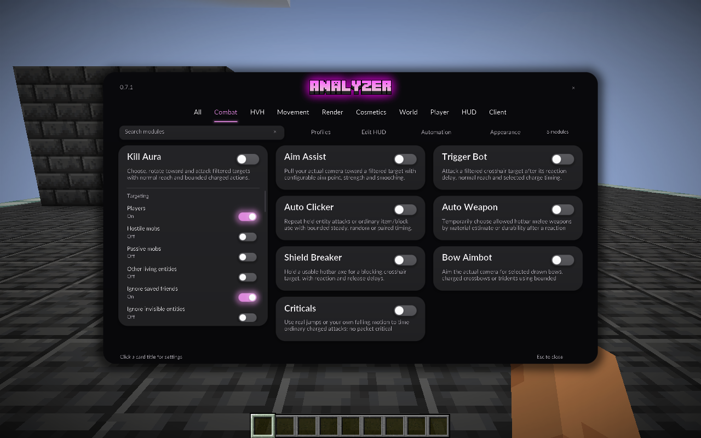
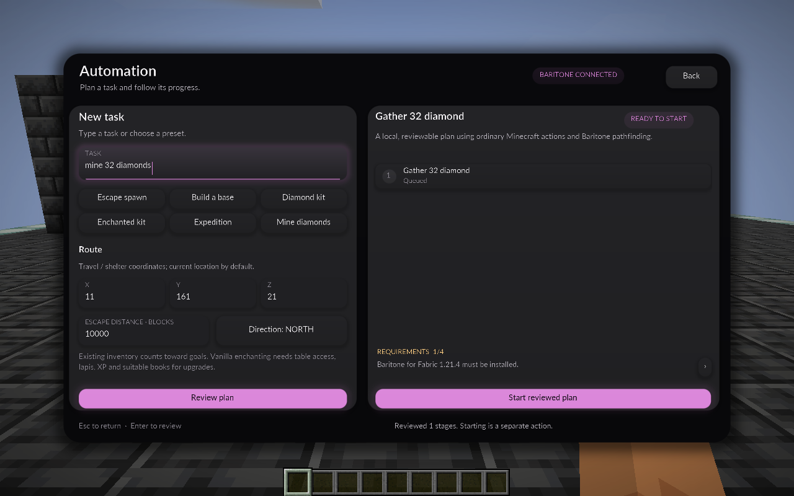
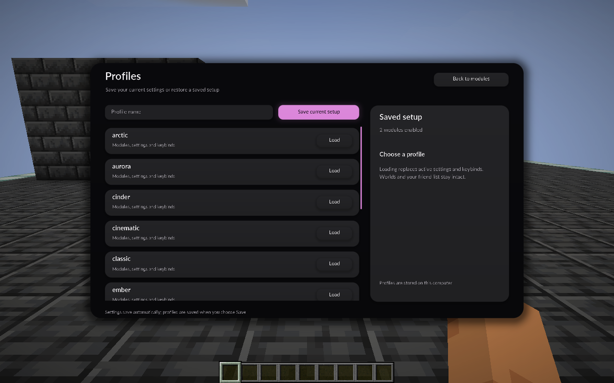
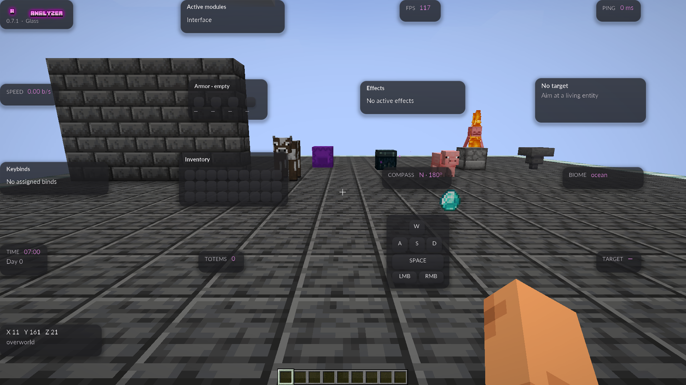

# Studio screens, shader HUD and supplied branding — 0.7.2

Studio's auxiliary screens now share its charcoal shader surfaces, rounded controls and Lato typography. Profiles, Automation, the HUD editor and precise numeric entry no longer open or draw the previous Workspace interface. Settings links use the selected module-menu layout and return to their actual parent. The deliberately selectable Workspace / Classic / Compact alternatives remain available.



## Screens and navigation

- **Profiles** has a dedicated Studio screen with save, selection, load and delete actions. Loading still explicitly replaces active settings and keybinds. Returning preserves the parent menu's selection/search; if a loaded profile selects another layout, Back opens that saved layout.
- **Automation** uses the same black shell and gray cards for its task composer, plan review and live progress. The actual controller, review/start distinction, pause/stop and task requirements are retained.
- **HUD editor** uses a neutral editing grid, a rounded shader dock and shader selection highlight. Dragging, arrow keys, snapping, theme/scale, enable/reset and saved positions still work. Widget settings and Menu settings return to the editor when closed. Tab/Enter/Space work on the dock.
- **Numeric entry** uses a shader modal and field with native Minecraft cursor, selection and keyboard handling. Finite-number validation, normalization, Apply/Cancel and parent return are retained.
- **Animation settings** remain ordinary Studio module cards; there is no separate legacy animation screen. Hand Tweaks' swing controls and other cosmetic settings open through Studio. Automation is also included because its previous screen had a separate old design.





## HUD

All 17 HUD widgets now submit their panels through the same original SDF shader renderer as Studio. Rounded keycaps, inventory/armor slots and target health bars use the shader path too. Radar and protection notices share the new HUD surface; projected ESP label panels use charcoal shader surfaces and the Studio font. Actual game data, selected targets, protection behavior, opacity, saved positions and HUD scale are retained.

HUD **Glass / Classic / Minimal / Neon** themes remain independent of the menu theme. All use the new geometry and font; they retain different fills/transparency/glow. Glass HUD cards are translucent over the live world; they do not apply the menu's full-screen scene blur. Shader failure retains a readable fallback. Vanilla hotbar, health, hunger and inventory screens remain Minecraft's native UI.



## Supplied logos

The user's `minecraft-text (1).png` and `minecraft-text.png` already contain RGBA transparency. Their bytes are preserved as `textures/brand/monogram.png` and `textures/brand/wordmark.png`, including the pink lettering, dark letter shadows and partially transparent glow. No background removal, recoloring or replacement artwork was performed.

The old generated A glyph and plain pink Home wordmark are removed. Home uses the supplied monogram and panorama wordmark; **Modules** provides neutral navigation. Studio uses the supplied wordmark in its header; the HUD watermark shows either supplied image, selected with **Watermark → Logo → Analyzer logo / A logo**. The default is Analyzer logo. Gameplay and the HUD editor never draw both together; the choice saves with active settings and named profiles, while the existing panel footprint and version caption are retained. Orbit keeps the large scene clear and shows the supplied monogram in the corner.


## Verification and delivery

The preceding complete Studio release passed **1,054 build assertions**, **542 Studio/HUD assertions** and **499 Home assertions**, with **48 new native captures**. The opt-in development fixture covers actual auxiliary navigation, profile save/load/delete with existing profile hashes preserved, numeric error/apply/cancel, Automation review without starting a task, editor dragging/persistence/parent return, all 17 actual HUD shader paths, four themes, live framebuffer differences, Radar, protection-notice presentation, six window/GUI-scale cases, motion zero and resource reload. Protection-banner presentation uses a labeled fixture snapshot without executing a task. A separate title-only Home regression checks the real world/server/options pages and vanilla fallback. [Validation](VALIDATION.md) records final counts and release hashes.

Run with Java 21:

```powershell
.\gradlew.bat build runStudioRefreshSmoke
.\gradlew.bat runHomeSmoke
```

Current native captures use `screenshots/analyzer-refresh-*.png`. Historical Studio/Home captures retain their older prefixes. Existing Prism worlds, active settings, profiles, friends, unrelated mods and Java preferences are preserved by the update.
