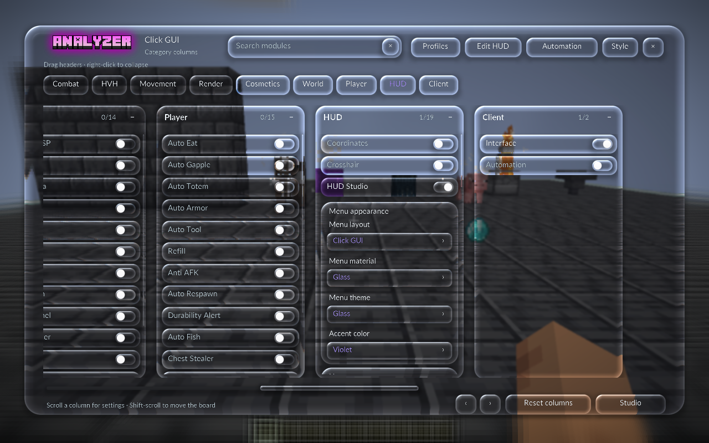
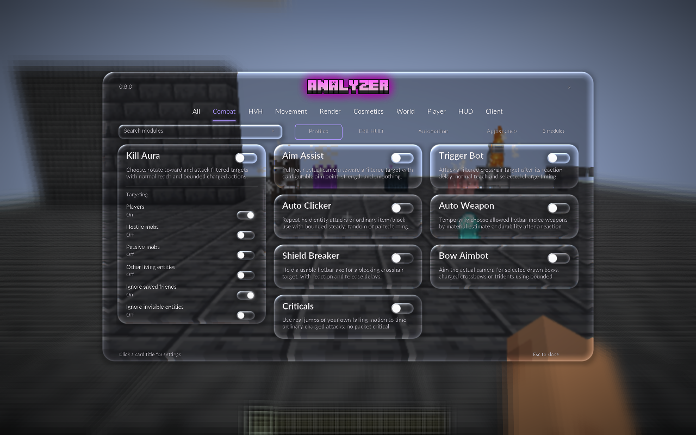
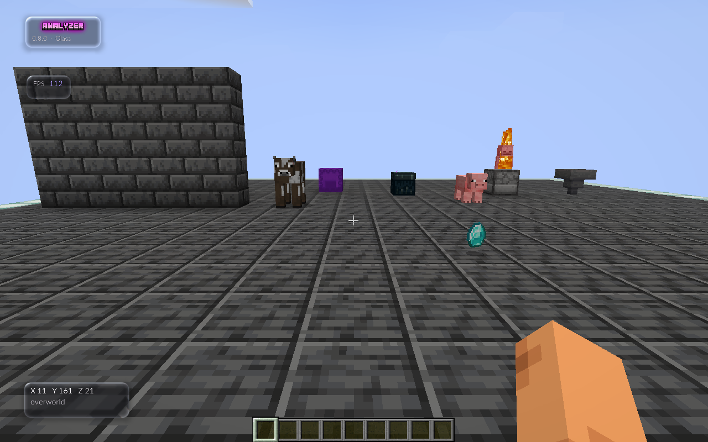
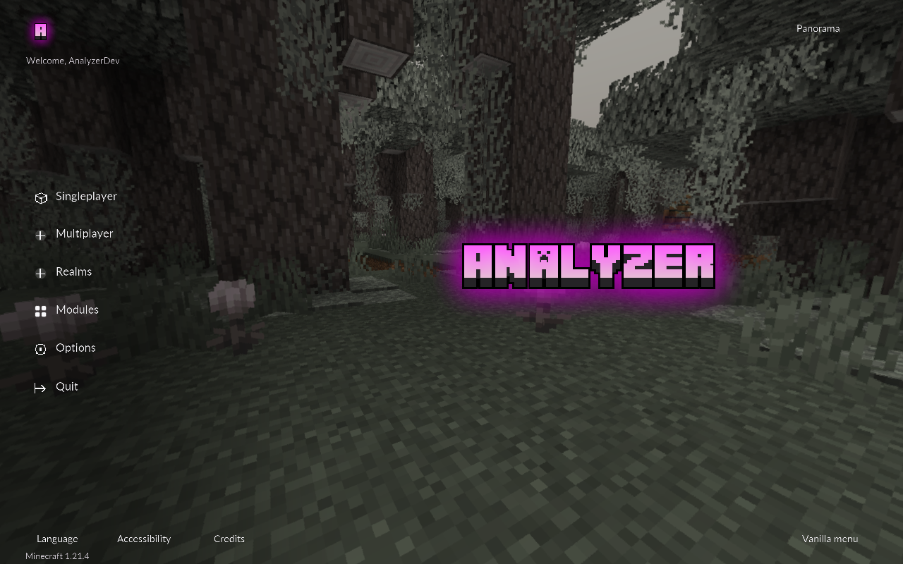

# Studio, Click GUI, liquid glass and supplied branding — 0.8.0

Studio and the new shader **Click GUI** are the only module layouts. Workspace, Classic and Compact are removed. Profiles, Automation, the HUD editor and precise numeric entry share native shader surfaces, rounded controls and Lato typography. Settings links use the current layout and retain their actual parent. Saved retired layout names migrate to Studio before the factory or Back to modules resolves a menu; all other fields are preserved and loading never rewrites the source profile file.


## Screens and navigation

- **Profiles** has a dedicated Studio screen with save, selection, load and delete actions. Loading still explicitly replaces active settings and keybinds. Returning preserves the parent menu's selection/search; if a loaded profile selects the other current layout, Back opens it. Premade profiles with retired layout names return to Studio.
- **Automation** uses the same black shell and gray cards for its task composer, plan review and live progress. The actual controller, review/start distinction, pause/stop and task requirements are retained.
- **HUD editor** uses a neutral editing grid, a rounded shader dock and shader selection highlight. Dragging, arrow keys, snapping, theme/scale, enable/reset and saved positions still work. Widget settings and Menu settings return to the editor when closed. Tab/Enter/Space work on the dock.
- **Numeric entry** uses a shader modal and field with native Minecraft cursor, selection and keyboard handling. Finite-number validation, normalization, Apply/Cancel and parent return are retained.
- **Animation settings** remain ordinary Studio module cards; there is no separate legacy animation screen. Hand Tweaks' swing controls and other cosmetic settings open through Studio. Automation is also included because its previous screen had a separate old design.


## Module layouts and Glass theme

**Studio** retains centered top navigation, three columns of rounded cards and inline expanded settings. **Click GUI** is a new category-column board using the same font and shader controls: category buttons reveal columns, headers drag or collapse, each column scrolls its settings and the horizontal rail reaches the wider board. Both separate inspection from module activation and provide Profiles, HUD editing, Automation and appearance settings.

**HUD Studio → Menu layout** offers only Studio / Click GUI. Menu and HUD themes remain independently **Glass / Classic / Minimal / Neon**, with **Rose / Mint / Violet / Gold** accents. Classic is still a theme; the old Classic layout is removed. All five current starter profiles open Studio while preserving their distinct module and visual presets.

Glass theme uses original liquid-glass GLSL instead of alpha transparency alone. It refracts an immutable scene capture through curved surfaces, with lightly frosted interiors, subtle color dispersion and directional edge highlights. **Menu material → Glass / Solid** controls background softness and the outer shell separately; optical cards and controls still work over a crisp Solid background. See [LIQUID-GLASS.md](LIQUID-GLASS.md) for render scope and measured native pixel differences.





## HUD

All 17 HUD widgets submit shader panels; Glass-theme panels now use the shared liquid-glass renderer. Rounded keycaps, inventory/armor slots and target health bars use the shader path too. Radar and protection notices share the new HUD surface; projected ESP label panels use charcoal shader surfaces and the Studio font. Actual game data, selected targets, protection behavior, opacity, saved positions and HUD scale are retained.

HUD **Glass / Classic / Minimal / Neon** themes remain independent of the menu theme. All use the new geometry and font; they retain different fills/transparency/glow. Glass HUD panels refract the live world from their own captured scene and keep HUD opacity and placement settings; they do not apply the menu's full-screen scene blur. Shader failure retains a readable fallback. Vanilla hotbar, health, hunger and inventory screens remain Minecraft's native UI.



## Supplied logos

The user's `minecraft-text (1).png` and `minecraft-text.png` already contain RGBA transparency. Their bytes are preserved as `textures/brand/monogram.png` and `textures/brand/wordmark.png`, including the pink lettering, dark letter shadows and partially transparent glow. No background removal, recoloring or replacement artwork was performed.

The old generated A glyph and plain pink Home wordmark are removed. Home uses the supplied monogram and panorama wordmark; **Modules** provides neutral navigation. Studio uses the supplied wordmark in its header; the HUD watermark shows either supplied image, selected with **Watermark → Logo → Analyzer logo / A logo**. The default is Analyzer logo. Gameplay and the HUD editor never draw both together; the choice saves with active settings and named profiles, while the existing panel footprint and version caption are retained. Orbit keeps the large scene clear and shows the supplied monogram in the corner.




## Verification

The 0.8.0 build passes **2,364 assertions**. Native layout/optics acceptance passes **959 assertions with 11 captures**, and the Home regression passes **491 assertions with 31 captures**. The current fixture tests real legacy premade profile Load/Back, all five new starter defaults, HUD layout selection, nine category jumps, column drag/collapse, typed values and parent routes, independent theme/material, six framebuffer/GUI pairs, actual scene refraction and edge displacement, GL restoration, exclusive watermark logos, zero motion and resource reload. Home checks actual world/server/options pages and both current module layouts. [Validation](VALIDATION.md) records verification and delivery evidence separately.

```powershell
.\gradlew.bat build runLiquidLayoutSmoke
.\gradlew.bat runHomeSmoke
```

Current captures use `screenshots/analyzer-liquid-*.png`; runtime logs are `build/reports/liquid-layout-runtime.log` and `build/reports/liquid-home-runtime.log`.

## Historical 0.7.1–0.7.2 acceptance

The preceding complete Studio release passed **1,054 build assertions**, **542 Studio/HUD assertions** and **499 Home assertions**, with **48 new native captures**. The opt-in development fixture covers actual auxiliary navigation, profile save/load/delete with existing profile hashes preserved, numeric error/apply/cancel, Automation review without starting a task, editor dragging/persistence/parent return, all 17 actual HUD shader paths, four themes, live framebuffer differences, Radar, protection-notice presentation, six window/GUI-scale cases, motion zero and resource reload. Protection-banner presentation uses a labeled fixture snapshot without executing a task. A separate title-only Home regression checks the real world/server/options pages and vanilla fallback. [Validation](VALIDATION.md) records final counts and release hashes.

Run with Java 21:

```powershell
.\gradlew.bat build runStudioRefreshSmoke
.\gradlew.bat runHomeSmoke
```

The `screenshots/analyzer-refresh-*.png` images and commands above record the earlier Studio/HUD refresh. The old layout alternatives shown in earlier captures are no longer supported; they remain historical evidence. Delivery must preserve Prism worlds, unrelated active settings, profiles, friends, unrelated mods and Java preferences.
