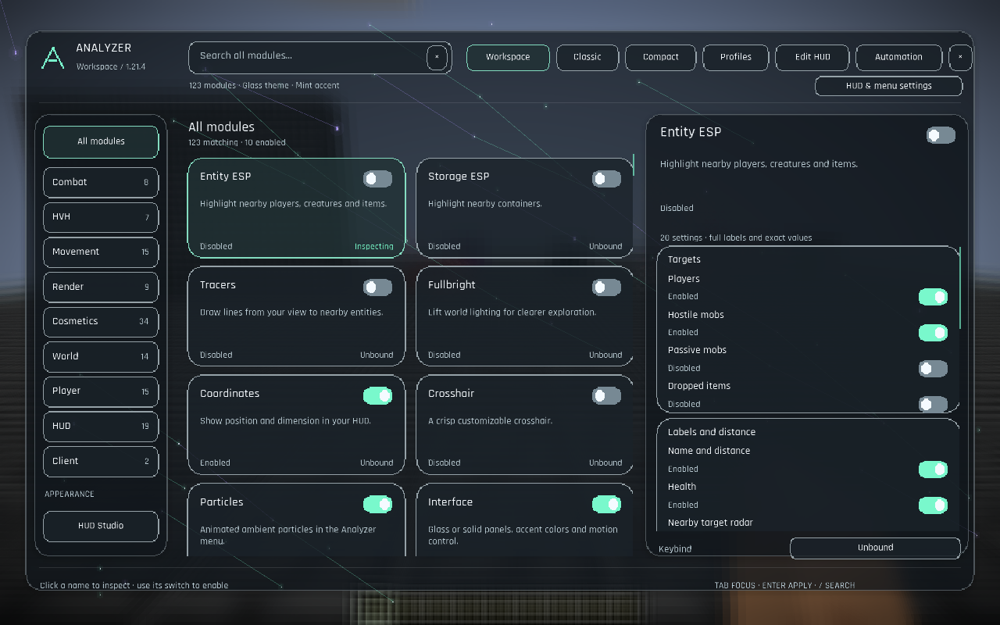

# Native UI overhaul

The October 11, 2026 update implements the user's selected **Focused workspace** direction, with **reference 3's rounded cards/switches** and **reference 2's glass appearance**. Workspace keeps sidebar browsing and a substantial settings inspector. Existing Classic and Compact alternatives remain available. Minecraft 1.21.4, Java 21 and Analyzer version 0.5.2 are unchanged.

## Implemented controls

Workspace now shares the native `CatalogScreen` control layer with the alternative menus. Its sidebar, two-column module cards and independently scrolling inspector use rounded surfaces, clear switches, grouped controls and full wrapped labels. Selecting a module inspects it; enabling/disabling uses a separate switch. Real scene frost supplies the Glass backdrop; Solid provides an opaque fallback. The glass effect does not simulate refraction.

Open **HUD Studio** through the appearance shortcut in the menu header, Workspace sidebar or HUD editor:

| Setting | Options | Saved behaviour |
|---|---|---|
| Menu layout | Workspace / Classic / Compact | Persists the layout used when opening Analyzer. |
| Panel material | Glass / Solid | Selects translucent scene frost or an opaque menu surface. |
| Menu theme | Glass / Classic / Minimal / Neon | Changes menu appearance independently of HUD theme. |
| Accent colour | Mint / Violet / Gold | Shares Interface's accent preference. |

These four HUD Studio controls alias the canonical Interface settings; changing either location changes the same value. The existing HUD **Glass / Classic / Minimal / Neon** themes remain independently selectable in HUD Studio or Edit HUD. Fresh HUD scale remains 60%; saved positions and scale remain intact.

The registry still contains **123 modules**. It exposes **1,091 settings**, consisting of **1,087 canonical settings and four presentation aliases**. The five current bundled profiles have been regenerated using canonical values only; saved user profile files are not overwritten. Existing Interface preferences remain the canonical source when importing old configurations; the aliases do not create competing saved copies.

## Input and navigation

- Click a module card/row to inspect; use its separate switch to toggle it. Classic retains draggable, collapsible, independently scrolling columns with inline settings; Compact retains its denser catalogue and inspector.
- Click a numeric value or right-click its slider row to enter an exact value, then Enter or Apply. Conditional settings retain saved values while hidden.
- **/** focuses search. **Tab / Shift+Tab** moves visible focus; **Enter / Space** activates the focused control. Arrow keys adjust supported setting values; **Page Up / Down** scrolls the inspector.
- Capture a module keybind from its inspector; Backspace/Delete clears it and Escape cancels capture. Changes save automatically.
- Shared catalogue controls supply labels through Minecraft's native narration hook. Actual spoken-output coverage depends on the user's Minecraft narrator configuration and remains separate from visual focus checks.
- Profiles, HUD and Automation retain the parent screen on Back, preserving browsing context. Profile loading is still an explicit replacement of module settings and keybinds. Opening Automation or restoring a profile does not start a task.

## Native captures

| View | Capture |
|---|---|
| HUD Studio menu controls | [Menu settings](screenshots/analyzer-ui-overhaul-menu-settings.png) |
| HUD editor | [HUD Studio](screenshots/analyzer-ui-overhaul-hud-studio.png) |
| Profile navigation | [Profiles](screenshots/analyzer-ui-overhaul-profiles.png) |
| Long settings | [Entity ESP](screenshots/analyzer-ui-overhaul-esp-settings.png), [Combat](screenshots/analyzer-ui-overhaul-combat-settings.png) |
| Menu themes | [Glass](screenshots/analyzer-ui-overhaul-theme-glass.png), [Classic](screenshots/analyzer-ui-overhaul-theme-classic.png), [Minimal](screenshots/analyzer-ui-overhaul-theme-minimal.png), [Neon](screenshots/analyzer-ui-overhaul-theme-neon.png) |
| Opaque fallback | [Solid](screenshots/analyzer-ui-overhaul-solid.png) |
| Alternative layouts | [Classic](screenshots/analyzer-ui-overhaul-classic-glass.png), [Compact](screenshots/analyzer-ui-overhaul-compact-glass.png) |
| 1280 × 800 | [GUI 2](screenshots/analyzer-ui-overhaul-workspace-1280-gui2.png), [GUI 3](screenshots/analyzer-ui-overhaul-workspace-1280-gui3.png), [GUI 4](screenshots/analyzer-ui-overhaul-workspace-1280-gui4.png) |
| 1920 × 1080 | [GUI 2](screenshots/analyzer-ui-overhaul-workspace-1920-gui2.png), [GUI 3](screenshots/analyzer-ui-overhaul-workspace-1920-gui3.png), [GUI 4](screenshots/analyzer-ui-overhaul-workspace-1920-gui4.png) |

Requested GUI scales can be clamped by Minecraft; runtime evidence records the effective size/scale. These are native client captures rather than the earlier browser composition.

## Verification scope

The final native run passes **280 assertions** and produces the **19 captures** linked above; the build passes **1,017 assertions**. A focused gameplay regression also passes 66 assertions plus 23 introductory UI checks. The verified build is published, installed in the existing Prism instance and included in the rebuilt Desktop import ZIP. Exact evidence and artifact hashes are in [VALIDATION.md](VALIDATION.md). The earlier comparison's **168 browser checks** covered simulated controls against the historical **1,086-setting** snapshot and are not native acceptance evidence.

The detailed [UI-OVERHAUL-PLAN.md](UI-OVERHAUL-PLAN.md) remains the acceptance specification. This update does not declare the full Automation state/capture matrix, spoken narrator output, every bright/dark contrast measurement, steady-frame comparison or other renderer/GPU checks complete. Gameplay, task-controller ownership and actual Automation states remain separate from appearance; prior runtime evidence applies to the artifacts it records.

Delivery follows the standing Prism workflow: publish the verified remapped JAR, rebuild `Analyzer-0.5.2-Prism-1.21.4.zip`, update the closed existing Analyzer instance, and verify hashes while preserving worlds and saved user files. Current delivery evidence is recorded in VALIDATION; the design screenshots alone do not prove installation.
