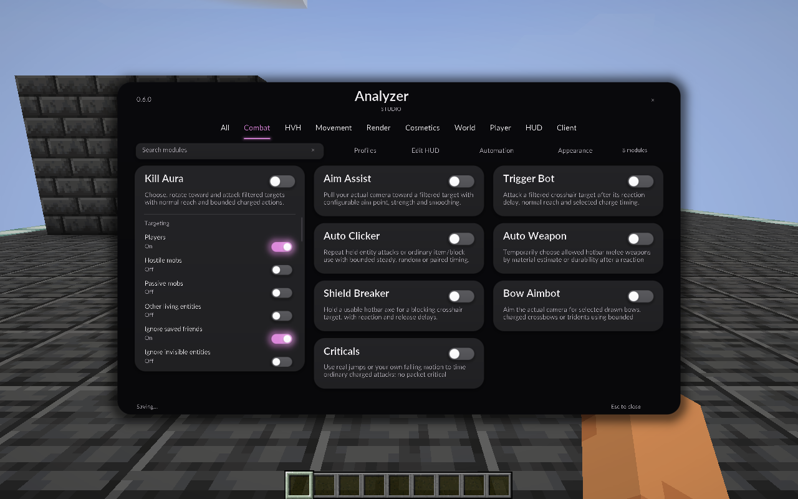

# Native Studio UI — Analyzer 0.6.0

**Status: Studio is implemented, verified and delivered to the existing Prism instance.** The final run passes 91 native checks and 1,030 build assertions with 16 reviewed captures; [VALIDATION.md](VALIDATION.md) records the installation and archive hashes. The earlier 0.5.2 Workspace overhaul is historical. This release follows the user's subsequent request for the third reference's black/gray menu and pink controls.

## What changed

Studio replaces the previous sidebar-and-inspector composition with a centered black-and-charcoal shell, category tabs across the top and three columns of rounded module cards. Settings expand inside their own cards. Long cards have an independent settings scroll, and the surrounding catalogue also scrolls. Titles use Lato Bold; descriptions and controls use Lato Regular. Enabled pills and slider fills use the Rose accent, with restrained glow behind the controls. Studio omits the ambient particle network.

Original GLSL signed-distance surfaces render rounded cards, pills, shadows and glow. These use the native Minecraft GUI matrices and clipping, and restore OpenGL state after drawing. Minecraft's Screen/input layer and native TTF rendering still handle interactions and text. There is no ImGui or embedded browser. Shader failure has a readable native fallback. Glass material also uses the existing scene-frost backdrop; Solid material gives the opaque black/gray presentation above. The glass effect does not simulate refraction.

The actual registered module settings remain the data source. The release retains **123 modules** and **1,091 exposed settings: 1,087 canonical settings plus four HUD Studio presentation aliases**. Gameplay and task-controller behavior are unchanged by menu rendering.

## Choose menus and appearance

Open **Appearance** in Studio, or the appearance shortcut in a retained menu/HUD editor, to expand **HUD Studio**.

| Setting | Options | Behavior |
|---|---|---|
| Menu layout | Studio / Workspace / Classic / Compact | Saves the menu used when opening Analyzer. |
| Panel material | Glass / Solid | Scene-frost/translucent surfaces or opaque surfaces. |
| Menu theme | Glass / Classic / Minimal / Neon | Menu styling independent of the HUD theme. |
| Accent colour | Rose / Mint / Violet / Gold | Shared canonical Interface accent. |
| HUD theme | Glass / Classic / Minimal / Neon | Independent HUD widget styling. |

Fresh defaults choose **Studio / Rose**. For the third reference's black/gray look, use **Studio / Rose / Glass theme / Solid material**. Glass theme and Glass material are separate controls.

The existing **Workspace** sidebar/catalogue/inspector, **Classic** draggable category columns and **Compact** menu remain selectable. Old saved preferences remain valid. The active Prism configuration was found to select Classic, which explains why reopening that instance did not show the Workspace overhaul. This release's delivery explicitly selects Studio/Rose/Glass theme/Solid material in that instance; other configuration fields, saved profiles, friends, worlds and unrelated mods are preserved. The recoverable configuration backup and installation audit belong in VALIDATION.

The four menu controls in HUD Studio alias Interface's canonical fields. They do not serialize as competing copies. Current bundled profiles use canonical fields; existing saved user profile files are seeded once and are not overwritten. Loading an existing saved profile can therefore restore an older menu choice. Fresh HUD scale remains 60%, and saved HUD scale/positions remain independent of menu size.

## Input and navigation

- Click a card title to expand/collapse its settings; use the separate pill to enable/disable the module.
- Scroll over an expanded card's settings to reach its final controls and keybind. At the scroll boundary, scrolling continues through the catalogue.
- Search finds modules across categories. Category tabs restrict the visible catalogue when search is empty.
- Click a numeric value or right-click its slider row for precise native entry; Enter applies it and returns to the card.
- **/** focuses search; **Tab / Shift+Tab** moves focus, **Enter / Space** activates a focused control, arrow keys adjust supported values, and **Page Up / Down** scrolls selected settings.
- Use the card's Keybind field to capture a key. Backspace/Delete clears it; Escape cancels capture.
- Profiles, Edit HUD and Automation return to their parent browsing context. Profile loading explicitly replaces active settings/keybinds. Opening Automation does not start a task.

The shared controls expose labels through Minecraft's narration hook. Actual spoken-output coverage is separate from visual focus checks.

## Current native captures

These files are actual Minecraft framebuffer captures:

| View | Capture |
|---|---|
| Combat cards and expanded settings | [Combat](screenshots/analyzer-studio-combat.png) |
| Black/gray Solid presentation | [Solid](screenshots/analyzer-studio-solid.png) |
| HUD Studio appearance settings | [Menu settings](screenshots/analyzer-studio-menu-settings.png), [Rose](screenshots/analyzer-studio-rose-settings.png) |
| Menu themes | [Glass](screenshots/analyzer-studio-theme-glass.png), [Classic](screenshots/analyzer-studio-theme-classic.png), [Minimal](screenshots/analyzer-studio-theme-minimal.png), [Neon](screenshots/analyzer-studio-theme-neon.png) |
| Retained layouts | [Classic](screenshots/analyzer-studio-retained-classic.png), [Compact](screenshots/analyzer-studio-retained-compact.png) |
| 1280 × 800 | [GUI 2](screenshots/analyzer-studio-1280-gui2.png), [GUI 3](screenshots/analyzer-studio-1280-gui3.png), [GUI 4](screenshots/analyzer-studio-1280-gui4.png) |
| 1920 × 1080 | [GUI 2](screenshots/analyzer-studio-1920-gui2.png), [GUI 3](screenshots/analyzer-studio-1920-gui3.png), [GUI 4](screenshots/analyzer-studio-1920-gui4.png) |

Minecraft may clamp a requested GUI scale; the runtime record includes effective scales. Earlier `analyzer-ui-overhaul-` screenshots show 0.5.2 Workspace, Classic and Compact. Their prior counts and checks describe that earlier build, not Studio.

## Verification and delivery scope

[VALIDATION.md](VALIDATION.md) owns final runtime counts, tested paths, release hashes and Prism preservation evidence. The full Automation state/capture matrix, narrator audio, every bright/dark contrast measurement, steady-frame comparison and additional renderer/GPU combinations are broader checks; this release does not claim that entire matrix is complete. [UI-OVERHAUL-PLAN.md](UI-OVERHAUL-PLAN.md) retains those acceptance requirements.

Delivery publishes the verified 0.6.0 remapped JAR, rebuilds `Analyzer-0.6.0-Prism-1.21.4.zip`, updates the closed existing Prism instance and compares installed/feed/build hashes. The actual instance folder is `instances/Analyzer-0.5.2-Prism-1.21.4`; its original import name does not identify the new mod version. See [PRISM.md](PRISM.md).

## Rendering research and fonts

LiquidBounce's [rounded-rectangle shader](https://github.com/CCBlueX/LiquidBounce/blob/nextgen/src/main/resources/resources/liquidbounce/shaders/circle/rounded_rect.fsh) and [UI blur shader](https://github.com/CCBlueX/LiquidBounce/blob/nextgen/src/main/resources/resources/liquidbounce/shaders/blur/ui_blur.frag) informed the rendering approach. [ThunderHack's native ClickGUI](https://github.com/Pan4ur/ThunderHack-Recode/blob/main/src/main/java/thunder/hack/gui/clickui/ClickGUI.java) provided an example of native Screen/input integration. These are research references; their source/assets were not copied into Analyzer. The exact architecture of the client in reference 3 cannot be established from the screenshot alone.

Studio bundles unmodified, static Lato Regular/Bold from official Google Fonts. Their upstream license is preserved in [LATO-OFL.txt](LATO-OFL.txt); Rajdhani remains available for legacy menus/HUD under [FONT-LICENSE.txt](FONT-LICENSE.txt). [THIRD-PARTY.md](THIRD-PARTY.md) records pinned sources and font hashes.
