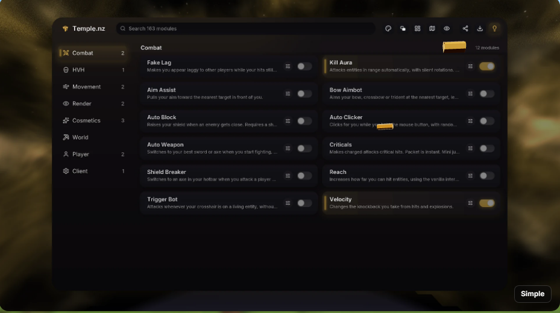
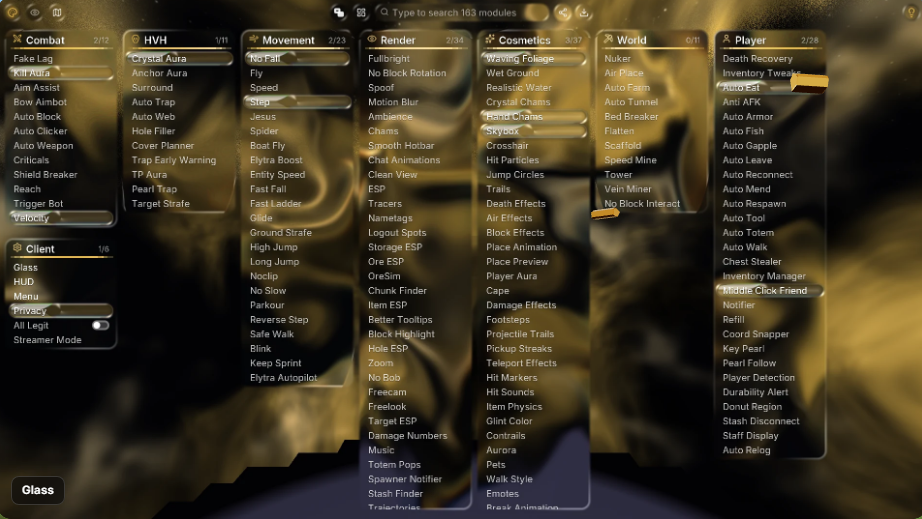
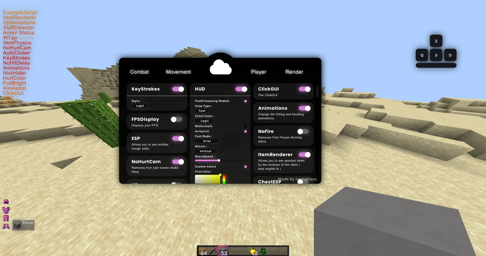
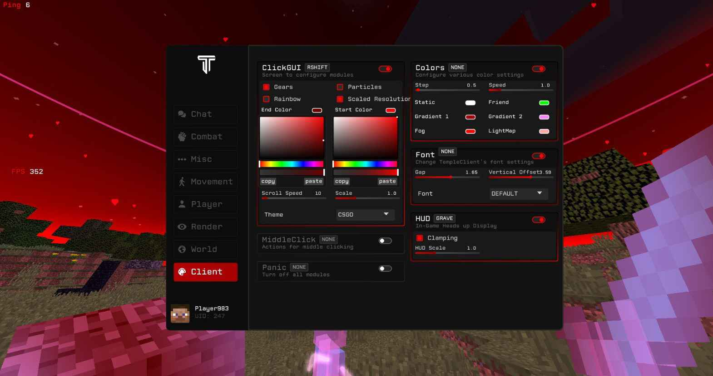
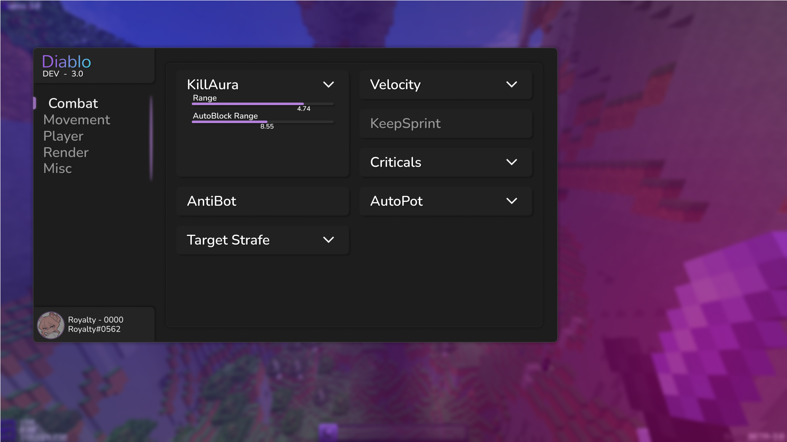

# Analyzer UI references and comparison

Five screenshots were supplied by the user on October 11, 2026. Their unchanged source copies are saved in [design/ui-references](design/ui-references). The user initially chose Focused workspace, then rejected the implemented result as too similar to the earlier interface and explicitly requested reference 3's black/gray menu, pink controls and shader rendering. **Studio is the current direction**: centered shell, top categories, three columns of cards, inline expanded settings and wider bold type. The earlier sidebar/inspector Workspace remains an optional layout. Images 1, 2 and 5 identify their clients; the other names describe visible layouts.

## Reference board

| Reference | Useful details | Tradeoff to resolve in Analyzer |
|---|---|---|
| [1 — Temple Simple](design/ui-references/reference-1-temple-simple.png) | Persistent search, category sidebar, two-column compact cards, separate switches and restrained selection accents. | Descriptions are truncated. Analyzer needs a full description and a larger inspector for long settings. Small toolbar icons need discoverable labels and keyboard focus. |
| [2 — Temple Glass](design/ui-references/reference-2-temple-glass.png) | Scene translucency, category overview and compact rows. | Detailed terrain competes with text. Retain an optional Glass material with dark readable surfaces; the latest reference 3 direction also needs a Solid black/gray presentation. |
| [3 — Rounded cards](design/ui-references/reference-3-rounded-cards.png) | **Current primary reference:** centered black shell, gray cards, top category navigation, bold sans serif names, obvious white-knob pink switches and settings inside each card. | Long expanded cards need their own scrolling as well as catalogue scrolling. Keep the last setting/keybind reachable. Restrict pink/glow to controls and selection instead of outlining every surface. |
| [4 — Red workspace](design/ui-references/reference-4-red-workspace.png) | Visible keybinds, detailed colour editors, labeled sliders, category navigation and bounded settings sections. | Dense controls and faint secondary text are difficult to scan. Give controls more space, units and exact numeric entry; do not require a saturated red theme to make selection visible. |
| [5 — Diablo](design/ui-references/reference-5-diablo.png) | Restrained dark surfaces, generous type hierarchy, clear category selection and expandable settings. | Large tiles leave considerable unused space with only a few controls. Keep readable type while fitting useful module content; enabled and inspected states need separate indicators. |

### 1 — Temple Simple

### 2 — Temple Glass

### 3 — Rounded cards

### 4 — Red workspace

### 5 — Diablo

The reference images are comparison material. Analyzer's components should be original; client logos, avatars and other reference assets should not become product assets.

## Historical comparison: two directions with identical content

The October 11 interactive comparison presented these directions with shared controls. The user initially selected Focused workspace; the subsequent rejection supersedes it as the default direction. The machine-local browser preview remains historical design evidence; its 168 browser checks covered the simulated comparison, not Minecraft rendering or gameplay. The native implementation and evidence are recorded separately in [UI-OVERHAUL.md](UI-OVERHAUL.md).

| | Focused workspace | Category desk |
|---|---|---|
| Catalogue | Persistent category sidebar and compact module cards with brief descriptions. | Several category columns with compact module rows and enabled counts. |
| Inspection | Substantial side inspector with full labels, grouped controls and its own scroll. | The same inspector beside the columns; opening settings does not expand a row into a long column. |
| Primary benefit | Clear browsing hierarchy and more room for descriptions. | Broad category overview and fast scanning across familiar module names. |
| Main cost | Another category requires a navigation action. | Less space per category; horizontal scrolling or fewer visible columns is necessary at smaller sizes. |
| Shared test content | All 123 modules; Entity ESP's 20 controls and Kill Aura's 33 controls. | Exactly the same catalogue, values and inspector content. |

Both compositions used a **123-module, 1,086-setting** snapshot. They compared layout rather than adding reference-only modules; preview edits remained inside the comparison. The current [module catalogue](MODULES.json) now exposes 1,091 settings, including four HUD Studio aliases for canonical Interface preferences. The snapshot count above describes the historical comparison.

Behavior retained across the new Studio and legacy menus:

- Search remains visible. Retain browsing context while opening Profiles, HUD or Automation and returning. Studio expands settings locally inside cards; long settings and the catalogue scroll independently.
- Selecting a module opens inspection. Its visible switch changes enabled state independently. Selection, enabled state, keybind and live waiting/error status have different indicators.
- Long settings use groups, wrapped labels, meaningful bounds, precise numeric entry and independently scrollable content. Conditional controls retain their saved values when hidden.
- Profiles clearly explain replacement of module settings and keybinds before loading. Loading and saving have reachable success/error feedback.
- HUD starts at the existing 60% default and preserves saved widget positions and scale. Menu sizing and ESP label sizing remain independent.
- Automation retains compose → review → start. Show real controller states: draft/reviewed, running, protecting, safety hold, paused, blocked, completed and stopped. Dependency availability is separate. Pause/Stop remain easy to reach; safety monitoring and a resource-blocked stage are distinct. A comparison may show sample states, but native task status must come from the controller.

## Current Studio direction

The earlier and recent Workspace screenshots both used a category sidebar, two-column catalogue and right inspector, together with narrow technical typography and outlined panels. Rounding and frost changed the surface treatment without changing that composition. The user's report of little visible improvement is consistent with that comparison.

Studio makes a visible structural change: a centered black/charcoal window, category tabs across the top, three columns of cards, settings expanding inside their cards, Lato Regular/Bold typography and Rose switches/slider fills. The ambient particle network and pervasive outlined panels are removed from Studio's content. Original GLSL signed-distance surfaces supply smooth rounding, shadows and control glow. Minecraft screens, native TTF text and input dispatch remain in use; there is no ImGui. The reference screenshot cannot itself prove the source client's rendering architecture.

**HUD Studio** exposes **Studio / Workspace / Classic / Compact** layouts, **Glass / Solid** materials, independent menu **Glass / Classic / Minimal / Neon** themes and **Rose / Mint / Violet / Gold** accents. Fresh defaults are Studio/Rose; the opaque reference presentation uses Solid material. The four menu aliases share canonical Interface fields. Saved profiles, HUD scale/positions, keybinds, friends and Classic window preferences remain valid.

Current captures use the `analyzer-studio-` prefix and are linked from [UI-OVERHAUL.md](UI-OVERHAUL.md). Older `analyzer-ui-overhaul-` captures and the 168 browser checks belong to earlier artifacts. Final runtime counts, release hashes and actual Prism delivery evidence are recorded in [VALIDATION.md](VALIDATION.md). The wider acceptance matrix, including comprehensive Automation-state captures, narrator audio, renderer/GPU combinations and steady-frame comparisons, remains separately scoped.

## Primary rendering references

- [LiquidBounce rounded rectangle shader](https://github.com/CCBlueX/LiquidBounce/blob/nextgen/src/main/resources/resources/liquidbounce/shaders/circle/rounded_rect.fsh): shader shape coverage and smooth edges.
- [LiquidBounce UI blur shader](https://github.com/CCBlueX/LiquidBounce/blob/nextgen/src/main/resources/resources/liquidbounce/shaders/blur/ui_blur.frag): framebuffer sampling and alpha-controlled blur.
- [ThunderHack native ClickGUI](https://github.com/Pan4ur/ThunderHack-Recode/blob/main/src/main/java/thunder/hack/gui/clickui/ClickGUI.java): native Minecraft Screen integration.
- [Official Google Fonts Lato resources](https://github.com/google/fonts/tree/5d3b76120a319730fda218cc7410174a462b32cb/ofl/lato): unmodified static fonts for Studio, distributed with [LATO-OFL.txt](LATO-OFL.txt).

These are architecture/design research references. Analyzer's Java and GLSL implementations are original; no GPL client code, cloud logo, avatar or other reference asset is bundled as a product component.
